# dcat-ap-plus-p450 — Components and Construction

| | |
|---|---|
| **Status** | Draft for review, 2026-10-08 |
| **Scope** | Every component of the cytochrome P450 library, how they connect, and the order in which they are built |
| **Source of truth** | [`components.json`](components.json) — 102 components, 173 connections. The website in `web/` renders it. The component reference in [§ 13](#13-component-reference) is generated from it by [`render_reference.py`](render_reference.py). |
| **Companion documents** | [`../../../cytochrome/LIBRARY-PLAN.md`](../../../cytochrome/LIBRARY-PLAN.md) (the plan this specifies) · `presentation.pdf` (the same content as slides) |

## Contents

1. [What this is](#1-what-this-is)
2. [How to read this document](#2-how-to-read-this-document)
3. [Design rules](#3-design-rules)
4. [The system at a glance](#4-the-system-at-a-glance)
5. [Repository layout](#5-repository-layout)
6. [The layers](#6-the-layers)
7. [Verdicts](#7-verdicts)
8. [End-to-end flows](#8-end-to-end-flows)
9. [Computing on the university servers](#9-computing-on-the-university-servers)
10. [Construction plan](#10-construction-plan)
11. [Verification](#11-verification)
12. [Risks and open decisions](#12-risks-and-open-decisions)
13. [Component reference](#13-component-reference)

---

## 1. What this is

`dcat-ap-plus-p450` is a library of knowledge about one enzyme, cytochrome P450, built in four layers.
Each layer is constructed from the ones beneath it.

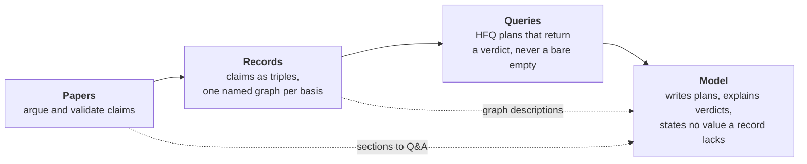

It is the fourth DCAT-AP-PLUS extension, after chromatography (borgia), proteomics (lavoisier) and
genomics (gospel). It reuses their machinery through a shared core rather than copying it a fourth time.
It is hosted in Buhera OS, where the CKG runtime, the vendored HFQ and ladder engines, and the
natural-language-to-DSL module already exist.

**What it is not.**

- It is not a simulator. Dynamics are ladders: a sequence of rungs with powers, composed as
  `1 − ∏(1 − pᵢ)`. The oscillator framing of the old monograph is retired.
- It is not a model that stores facts. The model is a compiled probe: it translates questions into
  plans, and the plans read records.
- It is not a claim about substrate scope. Recorded substrates are an extension; scope is an intension.
  The library records the first and refuses to infer the second (rule R9).

## 2. How to read this document

Every component has a **status** and a **phase**.

| Status | Meaning |
|---|---|
| **Exists** | Implemented and tested upstream; reused as is |
| **Adapt** | Implemented upstream for another domain; needs P450 adaptation |
| **New** | Exists nowhere; built here |
| **External** | A service or data source outside the user's repositories |

| Phase | Name | What it delivers |
|---|---|---|
| 0 | Prerequisites | Shared core, verdict algebra, ladder semantics, HFQ conformance, upstream defects, the university compute route |
| 1 | Papers | Ladder rewrites of the oscillator papers; the cycle-as-ladder paper |
| 2 | Querying | Schema, snapshots, domain modules, named graphs, the HFQ p450 world, Buhera integration |
| 3 | Downstream | Refinement, admission, grounding, ontology, metabolite ID, pharmacogenomics, spectroscopy, DDI |
| 4 | Model | Training corpus, training on AppHub, merge, evaluation, deployment |

Connections have a **kind**: *reuses*, *snapshots*, *feeds*, *emits*, *conforms to*, *analyses*,
*queries*, *dispatches*, *trains*, *deploys*, *runs on*, *documents*. In the diagrams, solid arrows are
data or control flow and dotted arrows are reuse of code.

Component names in `monospace` are ids from `components.json`; each links to its entry in § 13.

## 3. Design rules

These hold for every component. A change that breaks one is a design change and must be argued in a
paper, not made in code.

| # | Rule | Origin | Enforced by |
|---|---|---|---|
| R1 | **The model proposes; the records decide.** No value enters a record because a model said so. | okgg, Part III | `llm.eval` (zero unbacked values); `sem.ontology` witness |
| R2 | **Basis is never laundered.** Tags compose as max under stated < supplied < derived. A value computed from a supplied value is not stated. | honjo-masamune, chromatography `provenance` | [`core.provenance`](#core.provenance) |
| R3 | **No bare empty.** Every step ends in a labelled verdict; every label except `answered` and `empty` names a blocker. | HFQ, chromatography `verdicts` | [`core.verdicts`](#core.verdicts) |
| R4 | **The network is touched in one place.** Only `dom.fetch` contacts external services; everything else reads dated, content-addressed snapshots. | HFQ adapters (`adapters.py:15`) | code review; `dom.fetch` is the only module importing an HTTP client |
| R5 | **A stored value is valid only for its stage.** Every derived value carries the digest of the content and conventions it was computed on. | chromatography `identifiers.Stage` | [`core.identifiers`](#core.identifiers) |
| R6 | **Every class has its own IRI.** A distinction drawn in the schema reaches the emitted RDF. Measured and computed observations are never one `rdf:type`. | chromatography schema; SGV receiver collapse | [`schema.audit`](#schema.audit) (zero lost pairs) |
| R7 | **Change upstream, then re-vendor.** Code vendored into Buhera is byte-exact and pinned; a fix is made in the upstream repository first. | Buhera spec rule M1 | Buhera specs; [`q.conformance`](#q.conformance) |
| R8 | **Refined values ride alongside.** Asserted triples are never rewritten; refined values are stage-annotated annotations (RDF-star), never slots. | ART conservativity; admission tex:379 | [`sem.refinement`](#sem.refinement) |
| R9 | **Scope is not inferred.** A substrate list is never closed under similarity to claim what an isoform *can* metabolise. | borgia `chem-dcat-ap-querying.tex:738`; ART tex:1816 | [`dom.chemistry`](#dom.chemistry); N3 states the position |
| R10 | **Every claim has a plan.** Each claim a paper makes ships as an HFQ plan with its expected verdict, and that pair is a test. | this specification | [`q.plans`](#q.plans) |
| R11 | **Heavy work runs on the university servers.** Validation, catalogue builds, admission, ontology runs, training and evaluation are lattice units on AppHub. | user decision | § 9 |
| R12 | **Every number on a front page is read from a record.** No constant is copied into a page or a module. | `/protein-modelling` thesis, made strict | [`rt.p450module`](#rt.p450module), [`rt.web`](#rt.web) |

## 4. The system at a glance

Twelve layers, stacked from where computation runs to the papers that argue for it.

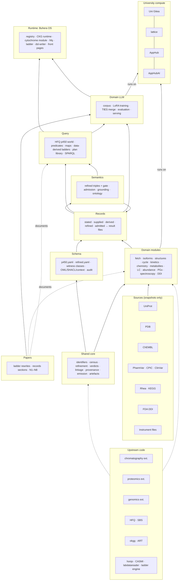

The single data path that every value follows, from a source to an answer:

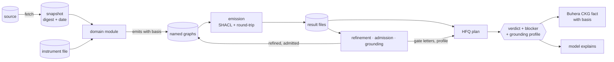

## 5. Repository layout

The package lives at `levinthal/dcat-ap-plus-p450/` and follows the layout of
`dcat-ap-plus-proteomics`, the most complete sibling.

```
dcat-ap-plus-p450/
├── README.md                     what it is, results table, usage (proteomics README is the model)
├── Makefile                      thin wrapper over the uv CLI and the web build
├── pyproject.toml                uv; ruff, mypy, pytest, pre-commit
├── src/
│   ├── dcat_ap_plus_core/        the shared core (phase 0), extracted from chromatography at a pinned commit
│   │   ├── identifiers.py  census.py  refinement.py  verdicts.py
│   │   ├── linkage.py  provenance.py  emission.py  artefacts.py
│   │   └── PROVENANCE.md         upstream repository, commit, and every change made since
│   └── dcat_ap_plus_p450/
│       ├── cli.py                fetch · emit · admit · ground · catalogue · artefacts · evaluate
│       ├── schema/               p450.yaml  refined.yaml  witness.yaml
│       ├── fetch/                one module per source; the only network code
│       ├── isoforms.py  structures.py  cycle.py  kinetics.py  chemistry.py
│       ├── metabolites.py  separation.py  abundance.py  pgx.py  spectroscopy.py  ddi.py
│       ├── maps.py               isoform translation maps
│       ├── admission.py  ground.py
│       └── emission.py           P450-specific emission on top of the core
├── artefacts/                    generated OWL, SHACL, JSON-LD context (committed)
├── snapshots/                    dated, digest-named source snapshots (licence-filtered; see § 9.3)
├── results/                      result files, admission outputs, evaluation summaries
├── plans/                        one .hfq plan per claim, with expected verdicts
├── model/                        corpus/  train/  eval/  serve/
├── tests/                        synthetic fixtures; every module tested without network
├── notebooks/                    one per part, as in proteomics
├── docs/
│   ├── specifications/           this document, components.json, presentation
│   ├── specification/            NN-*.md, one rule file per part (proteomics convention)
│   └── dcat-ap-plus-p450/        the N1 paper (dcat-ap-plus-450.tex)
└── web/                          the front page (Vite + React)
```

Two rules for the layout. Directory names `data/`, `lib/` (outside `web/src/lib`), `build/`,
`output/`, `out/` and `logs/` are ignored by the levinthal root `.gitignore` at every depth, so they
must not be used for anything that has to be committed. And `snapshots/` is subject to source
licences: what may not be redistributed is hidden from the public GitHub origin (§ 9.3).

## 6. The layers

### 6.1 University compute

All heavy work runs on AppHub (Uni Greifswald). AppHub accepts no inbound connection, so a task travels
as a **lattice unit**: `lattice wrap` writes `.lattice/<unit>/` on the laptop, commits and pushes it to
`git.uni-greifswald.de`; on AppHub, `git pull` and `bash .lattice/<unit>/run.sh --detach` build the
environment, run the shards in parallel, and push results to `lattice-results/<unit>`.

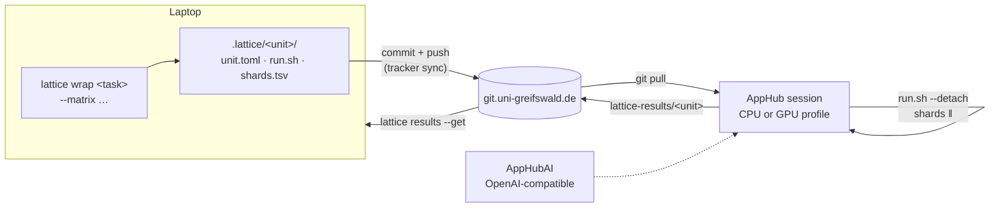

Components: [`compute.lattice`](#compute.lattice), [`compute.gitea`](#compute.gitea),
[`compute.apphub`](#compute.apphub), [`compute.apphubai`](#compute.apphubai),
[`compute.tracker`](#compute.tracker). § 9 lists every unit this package defines.

### 6.2 Sources

Twelve sources, each read only through a snapshot. A snapshot is a directory named by the date and the
SHA-256 of its content; its manifest records the query, the retrieval time, the licence, and the
digest. A snapshot is never edited; a new fetch makes a new snapshot.

| Source | What is taken | First needed by | Licence note |
|---|---|---|---|
| [UniProt](#src.uniprot) | 57 human CYPs, POR, CYB5A: sequence, features, cross-references | `dom.isoforms` | CC BY 4.0 |
| [PDB](#src.pdb) | CYP structures (e.g. 1TQN), heme site, ligands | `dom.structures` | free |
| [Rhea](#src.rhea) | reactions for EC 1.14.14.1 and relatives | `q.world` | CC BY 4.0 |
| [KEGG](#src.kegg) | hsa00982, hsa00983, hsa00140, hsa00590 | `dom.ddi` | **restricted**: do not redistribute |
| [ChEMBL](#src.chembl) | Ki, IC50, TDI against CYP targets | `dom.kinetics` | CC BY-SA 3.0 |
| [PharmVar](#src.pharmvar) | star-allele definitions | `dom.pgx` | check terms |
| [CPIC](#src.cpic) | allele function, activity scores, phenotype tables | `dom.pgx` | CC0 |
| [ClinVar](#src.clinvar) | submissions incl. drug-response significance | `dom.pgx` | public domain |
| [FDA DDI tables](#src.fda) | index substrates, inhibitors, inducers by strength | `dom.ddi` | public domain |
| [Spectral libraries](#src.spectral) | reference MS/MS of drugs and metabolites | `dom.metabolites` | per library |
| [Instrument files](#src.instruments) | UV-vis, LC-MS, HPLC raw data | `dom.spectroscopy`, `dom.metabolites` | lab-owned |
| [Monograph corpus](#src.monograph) | the 21 existing papers and their validation | papers | own work |

DrugBank and PharmGKB are deliberately absent from the first release: their licences restrict
redistribution, and anything in the snapshots can end up in the model's training data.

### 6.3 Upstream code

Nineteen modules in seven repositories are reused. The graph distinguishes **exists** (used as is) from
**adapt** (rewritten for P450 inside this package, with the upstream file named in `PROVENANCE.md`).

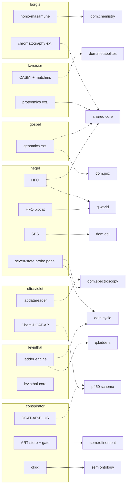

Known defects in upstream code that this package must not inherit:

| Upstream | Defect | Effect on P450 | Where fixed |
|---|---|---|---|
| levinthal-core | U-lev-2: residue masses are average masses labelled monoisotopic, ~18.01 Da heavy each | peptide masses for CYP abundance would be wrong | upstream, phase 0 |
| levinthal-core | U-lev-3: folding unseeded, fails on wasm32; U-lev-4: `to_sentropy` constant | not used by P450 until fixed | upstream, phase 0 |
| ladder engine / HFQ | paper says `subfloor` and `empty`; code says `starved` and raises ParseError | every ladder verdict would contradict its paper | upstream, phase 0 (§ 7) |
| genomics `corpora/clinvar.py:121` | "drug response" collapses to "O" | loses the pharmacogenomic signal | upstream, phase 0 |
| gospel `pharmacogenetics/analysis.py:161` | `KeyError`; averages alleles instead of summing | unusable | not reused; `dom.pgx` is new |
| lavoisier `MSAnnotator` | isotope model returns empty silently; test imports a missing module | no isotope evidence for Fe or halogens | in `dom.metabolites` |
| lavoisier CASMI | element set lacks F, Br, I, Fe | most drugs and heme unassignable | in `dom.metabolites` |
| honjo-masamune | d-block out of scope | no iron chemistry | out of scope for `dom.chemistry`; heme handled by `dom.cycle` and `dom.spectroscopy` |
| raw2dcat-converter | `kg/`, `federation/`, `individuate/`, `analysis/` hold only `__pycache__` on `main` | that code is not reusable until its source is found | ask the user |
| HFQ | three copies (hegel Python, hegel JS, borgia JS) | answers could differ by runtime | `q.conformance`, phase 0 |

### 6.4 Shared core

The generic machinery, extracted once from `dcat-ap-plus-chromatography`, which has CI, typing and
fifteen test modules. It starts as `src/dcat_ap_plus_core/` inside this package with a `PROVENANCE.md`
naming the upstream commit, and is promoted to its own package when a second extension switches to it
(decision D2).

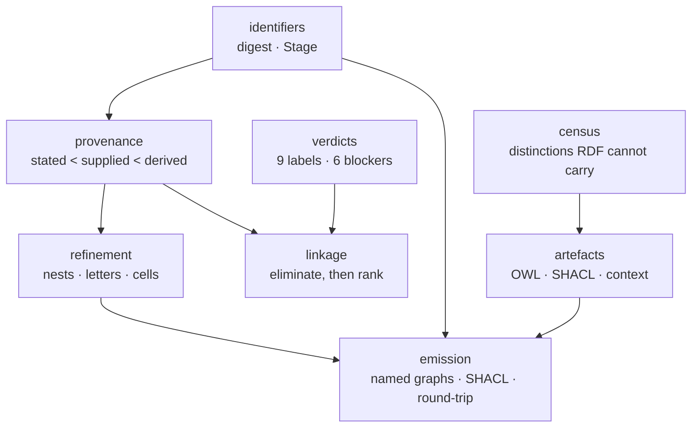

| Module | Public surface (sketch) | Acceptance |
|---|---|---|
| `identifiers` | `digest(obj) -> str`; `content_digest(bytes) -> str`; `Stage(content, conventions)` | identical inputs give identical digests across runs and machines; a changed convention changes the stage |
| `provenance` | `Basis` enum; `combine(*bases) -> Basis` (max) | no function returns a lower basis than its inputs |
| `refinement` | `refine(graph, order) -> dict[triple, Refined]`; `Nest`, `PairStatus` | conservativity: projecting refined values away returns the graph exactly |
| `verdicts` | `Label`, `Blocker`, `Evidence`, `assign(evidence) -> Verdict`; `from_hfq(step) -> Verdict` | every HFQ verdict maps to exactly one label (§ 7); a label without a blocker is only `answered` or `empty` |
| `linkage` | `link(records, bases) -> list[Link]` | no returned link is contradicted by a stated field |
| `census` | `census(schema_view) -> Census` | reports class/slot fibres sharing an IRI and the pairs they lose |
| `artefacts` | `generate(schema) -> {owl, shacl, context}` | generated SHACL validates the synthetic fixtures; includes the genomics SHACL repairs |
| `emission` | `emit(records, schema) -> Dataset` (rdflib); `round_trip(file) -> bool` | every result file conforms and parses back to the same quads |

### 6.5 Schema

A LinkML extension importing DCAT-AP-PLUS and Chem-DCAT-AP, in its own IRI space
`https://w3id.org/nfdi-de/dcat-ap-plus/p450/` (registration pending). The class sketch below is a
proposal for N1; the final classes are decided by the census and the receiver audit, not by this
diagram.

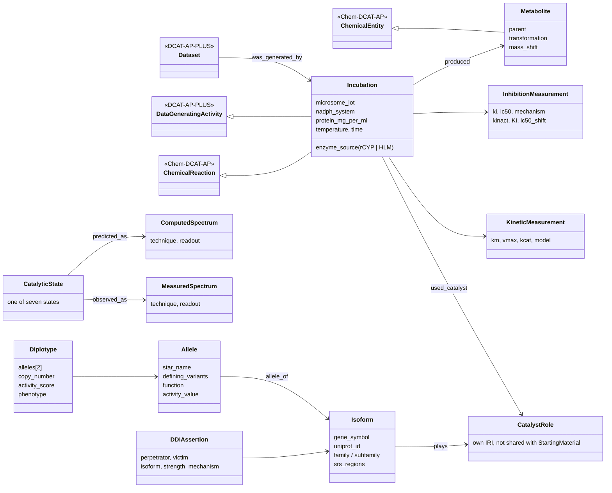

Two schema decisions are fixed by the design rules:

- **`CatalystRole` has its own IRI** (R6). In Chem-DCAT-AP, `Catalyst` and `StartingMaterial` share the
  exact mapping `VOC4CAT:0000194`; under that mapping a query cannot tell an enzyme from a substrate.
- **`MeasuredSpectrum` and `ComputedSpectrum` are distinct classes** (R6). The semiotic-verdicts paper
  shows that six activity classes emit as `prov:Activity` and become indistinguishable; the remedy is a
  fibre-unique `rdf:type`.

The **witness classes** (`schema.witness`) declare which activities count as contact and which as
derivation, so the grounding queries in § 7.3 can be run:

| Witness set | Proposed members |
|---|---|
| A_c (contact activities) | `Incubation`, `SpectralAcquisition`, `LCMSAcquisition`, `Genotyping` |
| U_c (contact inputs) | `Instrument`, `MicrosomeLot`, `RecombinantEnzyme` |
| A_d (derivation activities) | `MetaboliteIdentification`, `PhenotypeAssignment`, `LadderEvaluation`, `SpectrumComputation` |
| U_d (derivation inputs) | `Snapshot`, `ReferenceSpectrum` |
| G_d (derivation agents) | `prov:SoftwareAgent` |

### 6.6 Domain modules

One module per experimental aspect. Each reads snapshots and instrument files and emits records with a
basis; none of them answers questions.

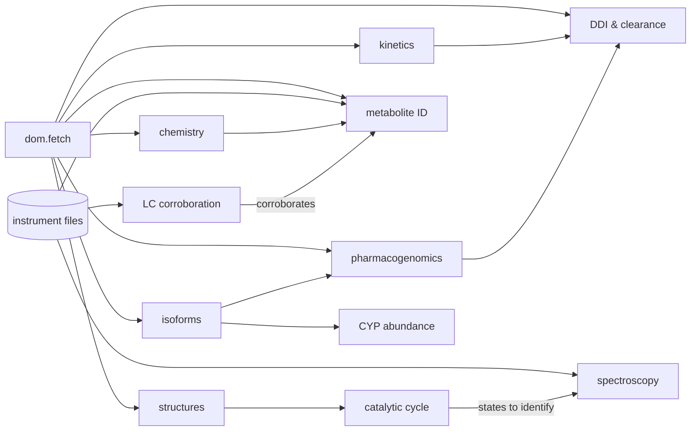

| Module | Input → output | Basis of its records | Acceptance |
|---|---|---|---|
| [`dom.fetch`](#dom.fetch) | source query → snapshot dir + manifest | — | re-fetch with no upstream change gives the same digest; no other module imports an HTTP client |
| [`dom.isoforms`](#dom.isoforms) | UniProt snapshot → 57 isoforms, families, SRS, CYP2D6/2D7 pair | supplied | count = 57; SRS positions per Gotoh 1992 on CYP2 family |
| [`dom.structures`](#dom.structures) | PDB/GLB → heme site, access channels | supplied | Fe position of 1TQN reproduces the GLB pipeline value |
| [`dom.cycle`](#dom.cycle) | seven states, rung powers → ladder, composite, `subfloor` | derived | ladder tests incl. both refusals of `def:refuse-climb` |
| [`dom.kinetics`](#dom.kinetics) | ChEMBL + incubations → Km, Vmax, Ki, IC50, kinact/KI with units and conditions | supplied / stated | two values compared only under declared tolerances; undecided where either side is supplied |
| [`dom.chemistry`](#dom.chemistry) | SMILES → structure with stated/supplied tags, candidate sites | supplied / derived | never asserts scope (R9) |
| [`dom.metabolites`](#dom.metabolites) | spectra + parent → metabolite ID or decline | stated + derived | licensed only when mass rule and spectral match agree; every decline has a reason |
| [`dom.chromatography`](#dom.chromatography) | LC runs → parent/metabolite peak fields | stated | retention corroborates, never identifies |
| [`dom.abundance`](#dom.abundance) | surrogate peptides → isoform abundance | derived | peptides mapped by sequence, not by label |
| [`dom.pgx`](#dom.pgx) | genotypes + PharmVar/CPIC → diplotype, activity score, phenotype | supplied / derived | activity score summed, never averaged; CPIC tables reproduced exactly |
| [`dom.spectroscopy`](#dom.spectroscopy) | UV-vis now, EPR/rR/Mössbauer new → state assignment | stated + derived | minimal probe set of `exp_04_panel` reproduced |
| [`dom.ddi`](#dom.ddi) | kinetics + PGx + pathways → DDI assertions | derived | FDA index pairs recovered with stated strength |

The biotransformation rules for `dom.metabolites`:

| Transformation | Mass shift (Da) | Notes |
|---|---|---|
| hydroxylation / N-, S-oxidation | +15.9949 | the most common P450 product |
| demethylation (N-, O-) | −14.0157 | dealkylation family |
| dehydrogenation / desaturation | −2.0157 | atypical reactions atlas |
| epoxidation | +15.9949 | isobaric with hydroxylation; needs MS/MS |
| hydroxylation + dehydrogenation | +13.9793 | ketone formation |
| glucuronidation (downstream) | +176.0321 | phase II, flagged as not P450 |
| GSH adduct (reactive metabolite) | +305.0682 | with neutral loss −129.0426 |

### 6.7 Records

Records are named graphs, one per basis, packed into one JSON-LD result file per dataset. The layout
follows proteomics, which already emits 34 files and 4.9 million quads this way.

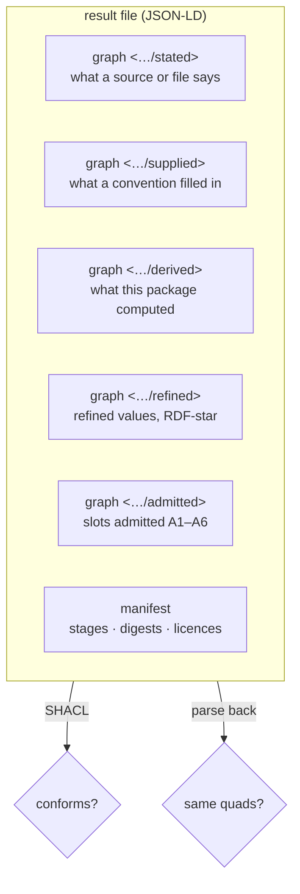

A record in the derived graph, sketched in TriG:

```trig
GRAPH <https://w3id.org/nfdi-de/dcat-ap-plus/p450/run/2026-10/derived> {
  p450:met/7f3a  a p450:Metabolite ;
      p450:parent        p450:cmpd/midazolam ;        # placeholder; the ChEBI IRI comes from the snapshot
      p450:transformation p450:Hydroxylation ;
      p450:massShift     "15.9949"^^xsd:decimal ;
      prov:wasGeneratedBy p450:act/MetaboliteIdentification/91c2 .
  p450:act/MetaboliteIdentification/91c2
      a p450:MetaboliteIdentification ;
      prov:used p450:snap/massbank/2026-10-08/3be1… ;
      prov:wasAssociatedWith p450:agent/dcat-ap-plus-p450/0.1.0 .
}
```

### 6.8 Semantics

Four analyses read the records and add to them without changing an asserted triple.

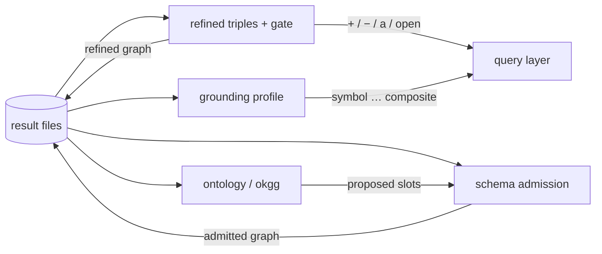

- **Refined triples and the gate** ([`sem.refinement`](#sem.refinement)). An empty answer is labelled
  `+` (witnessed no), `−` (not recorded), `a` (both) or `open` (a name the graph never uses).
- **Schema admission** ([`sem.admission`](#sem.admission)). Fields are scored by the pairs they tell
  apart. Cells the schema cannot split are where it learns. A candidate slot is admitted only under
  A1–A6: demanded, witnessed from the measured object, fresh optional predicate, closed vocabulary,
  identity by partition, promotion only at a federated stage.
- **Grounding profile** ([`sem.grounding`](#sem.grounding)). The five semiotic verdicts per record,
  reported beside every answer (§ 7.3).
- **Ontology** ([`sem.ontology`](#sem.ontology)). okgg facets over papers, sections and records; its
  proposals go to admission, never into the records directly (R1).

### 6.9 Query

HFQ with a `p450` world. The world is added upstream in hegel (R7), validated there, and re-vendored
into Buhera.

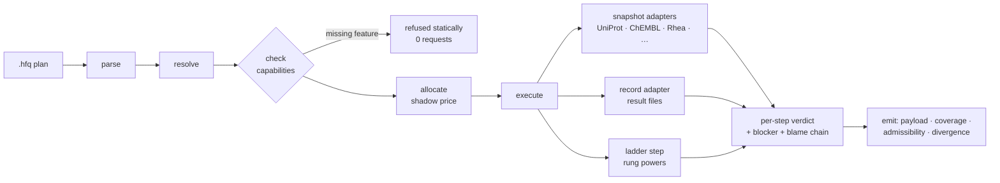

New predicates (`q.predicates`), added to `PREDICATE_FEATURES` following the `biocat.py:95` pattern:
`inhibits(?c, ?isoform)`, `induces(?c, ?isoform)`, `substrate_of(?c, ?isoform)`,
`metabolite_of(?m, ?parent)`, `allele_of(?a, ?isoform)`, `activity_score(?diplotype)`. HFQ `filter`
allows one comparison and no units; numeric range filtering with units is a language extension.

An illustrative plan in the current grammar. The `filter` with a unit-bearing attribute and the
`FDA` source need `q.predicates` and `q.world`:

```
plan cyp3a4_potent_inhibitors_on_fda_list {
  budget 300 requests
  let inh   = from CHEMBL
      ask inhibits(?c, "CYP3A4")
      within 120
  let potent = filter inh where ki_uM < 1.0
  let ids   = map potent via chembl_to_chebi
      expect partial 0.8
  let fda   = from FDA
      ask strong_inhibitor_of(?c, "CYP3A4")
      with ?c in ids
      within 60
      when starved emit partial
  emit fda with provenance
}
```

Its expected verdicts (the test `q.plans` keeps beside it): `inh` answer; `potent` answer; `ids`
answer with retention ≥ 0.8, or `starved` naming the map if retention falls below 0.8; `fda` answer or
partial. An empty `fda` is reported with a gate letter, not as "none".

A ladder over the seven-state cycle in the current grammar, with literal powers:

```
plan cyp3a4_cycle_coupling {
  budget 20 requests
  let states = from P450REC
      ask catalytic_states("CYP3A4")
      within 10
  let cycle  = ladder over states power 0.62, power 0.55, power 0.48, power 0.41 expect power 0.95
  emit cycle with provenance
}
```

Composite `1 − (0.38·0.45·0.52·0.59) = 0.9475 < 0.95`, so by `def:refuse-climb` the ladder is
refused with `subfloor`, shortfall 0.0025. Today's code returns `starved` here; § 7.1 fixes that. The
data-derived extension (`q.ladders`) replaces the literals with powers read from records or from the
ladder engine's computed intensive power, which `specs/ladder.md` §1 in Buhera already names as the
engine's purpose.

### 6.10 Runtime: Buhera OS

The library adds no runtime. It supplies records, a world, plans and a model to Buhera.

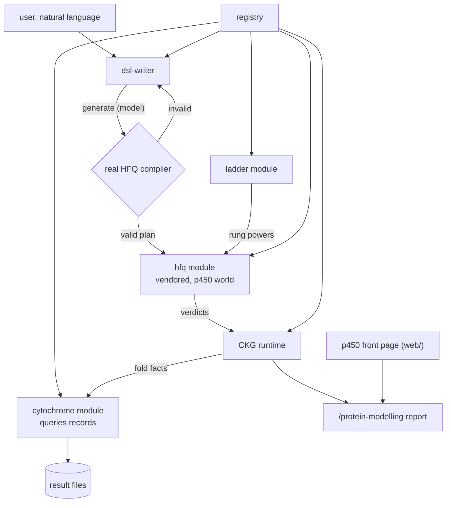

Changes in Buhera, in order:

1. Re-vendor HFQ with the `p450` world and the ladder fixes (R7).
2. Rewrite `cytochrome-module.js` so each op queries the records instead of holding constants (R12).
   Decision D7: rewrite in place, or keep the current module as the transaminase-comparison demo and add
   a new `p450` module.
3. Give every CKG fact its basis and grounding verdict. The current report mixes measured literature
   values (Soret 417→392 nm, the EPR g-tensor, Raman 795→758 cm⁻¹), framework-derived values (ΔM,
   ΣΔM = 4.963, the conditioned floor β), and framework values that read as clinical (CYP2D6 phenotype
   ΔM is not a CPIC activity score). After this change the report can say which is which.
4. Point `dsl-writer` at the domain model for `dslId: "hfq"`.

### 6.11 Domain LLM

The model is a compiled probe (`models/publications/purpose-based-protein-model`). It is trained only on
material the library produced, and it deploys behind a compiler that rejects any plan it gets wrong.

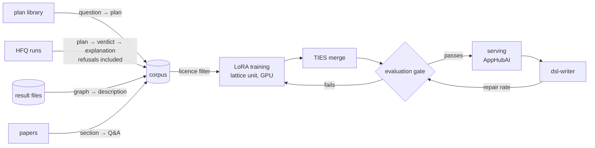

Corpus records are JSONL, one task per line:

```json
{"task": "plan", "question": "Which potent CYP3A4 inhibitors are on the FDA strong-inhibitor list?", "plan": "plan cyp3a4_potent_inhibitors_on_fda_list { … }", "source": "plans/cyp3a4_potent_inhibitors_on_fda_list.hfq"}
{"task": "explain", "plan": "…", "verdicts": [{"step": "ids", "verdict": "starved", "blocker": "corpus", "retention": 0.71}], "explanation": "The ChEMBL-to-ChEBI map kept 71% of the inhibitors, below the declared 80%, so the FDA step was not issued. The empty result says nothing about the FDA list."}
{"task": "refuse", "question": "What is the full substrate scope of CYP2D6?", "answer": "The library records substrates observed in incubations; it does not infer scope (rule R9). Here are the 214 recorded substrates, with their sources."}
```

Evaluation (`llm.eval`) does not use text similarity. It measures five things:

| Metric | Definition | Gate |
|---|---|---|
| parse-and-check rate | generated plans that parse and pass the capability check | ≥ 0.95 |
| verdict agreement | generated plan gives the same per-step verdicts as the reference plan | ≥ 0.90 |
| refusal accuracy | refuses exactly when the reference refuses | ≥ 0.95 |
| unbacked values | values stated that no record holds | **0** |
| repair rate | fraction of dsl-writer calls needing a repair | tracked in deployment |

### 6.12 Papers

A paper is finished when four things hold: its validation runs; its records emit and conform; its
plans return the verdicts it states; and its "Records and queries" section lists what the schema
cannot yet separate.

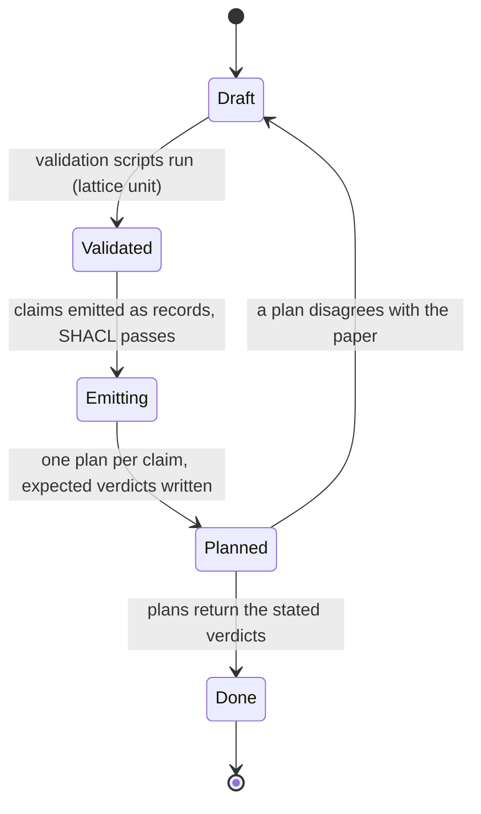

| Group | Papers | Work |
|---|---|---|
| Ladder rewrites (`pap.ladder`) | expression algebra (40 oscillator refs), multi-hop ET (22), address manifold (22), resting/bound states (18), Compound I (6), introduction (5) | replace oscillator dynamics by ladders; expression algebra first, because the others cite it |
| Records sections (`pap.records`) | the other 15 | add "Records and queries" |
| Merges | the two 57-isoform papers; database recovery + empty dictionary | one paper each |
| New | N1 schema · N2 cycle as ladder · N3 federated querying · N4 metabolite ID · N5 PGx admission · N6 DDI propagation · N7 spectroscopic discrimination · N8 domain model | see § 13 |
| Last | the introduction | written when everything it introduces exists |

## 7. Verdicts

Four kinds of verdict exist in the upstream code. They answer different questions and are kept as
separate axes. One of them, the step verdict, has two incompatible implementations; this section makes
one canonical.

### 7.1 Step verdicts (canonical)

**Proposal:** the nine ordered labels and six blockers of `dcat-ap-plus-chromatography/verdicts.py`
become canonical. They are a strict superset of HFQ's six. `subfloor` is added for ladders.

| Canonical label | Blocker | Rule (first that applies) | HFQ today | Ladder paper |
|---|---|---|---|---|
| `unsupported` | capability | a required feature is not declared | `surface` (model) | — |
| `starved` | upstream | an input step did not answer | `starved` (corpus) | — |
| `refused` | budget | the budget does not cover the request | `refused` (budget) | — |
| `exhausted` | budget or engine | halted during the request | `timeout` (engine) | — |
| `malformed` | record | the record does not parse | — | — |
| `subfloor` | floor | composite power below the declared target | `starved` (wrong) | `subfloor` |
| `empty` | — | completed; nothing matches | `empty` | `empty` for a rungless ladder (see note) |
| `underdetermined` | convention | an element has several readings | — | — |
| `incomplete` | record | a requested feature is absent | — | — |
| `answered` | — | none of the above | `answer` | — |

Notes:

- HFQ's `starved` also fires when a lossy map's retention falls below its declared expectation. Under
  the canonical algebra that is `starved` on the *next* step and `incomplete` on the map itself.
- The ladder paper refuses a rungless ladder with `empty`. Under the canonical algebra `empty` means
  "completed, nothing matches", which a ladder that never ran did not do. Decision D8: keep `empty`
  for it as the paper says, or call it `malformed`.

### 7.2 Empty-answer letters

Orthogonal to the step verdict. An `empty` step is further labelled by the gate (`sem.refinement`):
`+` witnessed absent, `−` not recorded, `a` both, `open` a name the graph never uses, `?` undecided.

### 7.3 Ground verdicts

Orthogonal again: per returned record, from the PROV graph. `CHAIN = prov:wasGeneratedBy/(prov:used/prov:wasGeneratedBy)*`.

| Verdict | (g, c, d) | Meaning |
|---|---|---|
| symbol | 000 | no generation recorded |
| collapsed | 100 | generated, but neither contact nor derivation reachable |
| index | 110 | traced to a contact with the measured object |
| icon | 101 | traced to a derivation |
| composite | 111 | both |

The three queries, with the witness classes of § 6.5:

```sparql
SELECT DISTINCT ?r WHERE { ?r prov:wasGeneratedBy ?a }                         # Q_g
SELECT DISTINCT ?r WHERE { ?r CHAIN ?a .
  { ?a a ?t FILTER(?t IN (A_c)) } UNION
  { ?a prov:used ?u . ?u a ?t FILTER(?t IN (U_c)) } }                            # Q_c
SELECT DISTINCT ?r WHERE { ?r CHAIN ?a .
  { ?a a ?t FILTER(?t IN (A_d)) } UNION
  { ?a prov:used ?u . ?u a ?t FILTER(?t IN (U_d)) } UNION
  { ?a prov:wasAssociatedWith ?g . ?g a ?t FILTER(?t IN (G_d)) } }              # Q_d
```

### 7.4 One answer, all axes

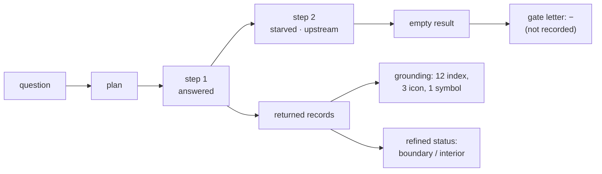

An answer the library returns therefore carries: the step verdicts with blockers and the blame chain;
for empty steps, a gate letter; for each record, a ground verdict and a refined status; and the coverage
and admissibility HFQ already emits.

## 8. End-to-end flows

### F1 · Snapshot ingestion

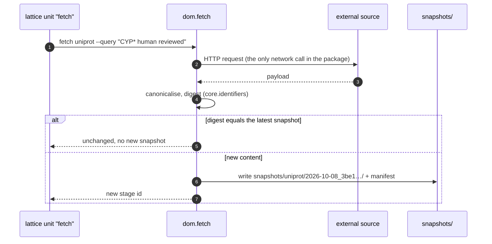

### F2 · From a paper's claim to a conforming record

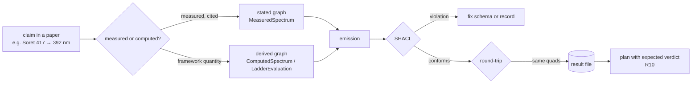

### F3 · Metabolite identification

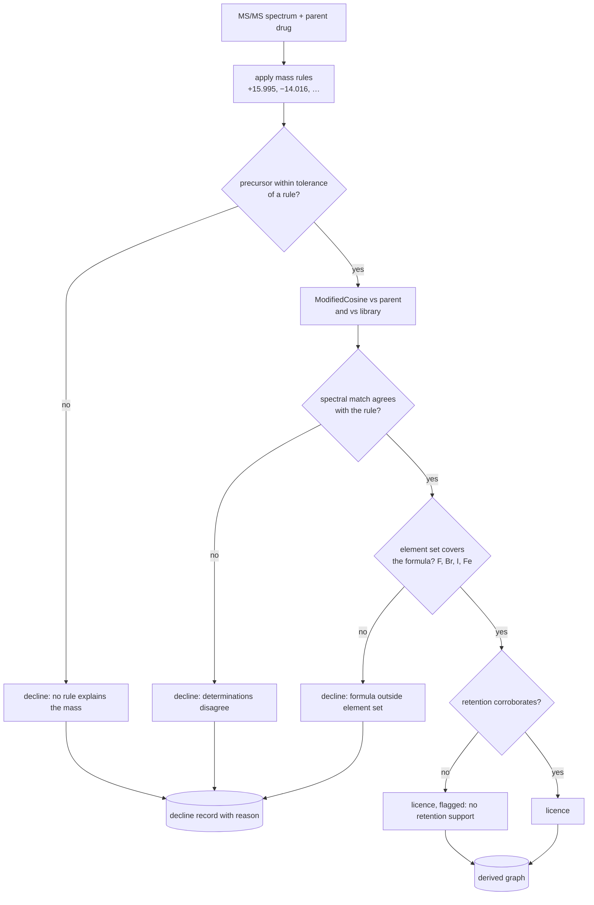

### F4 · Genotype to phenotype

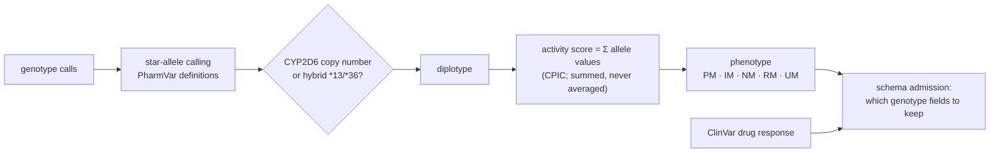

### F5 · A question answered through Buhera

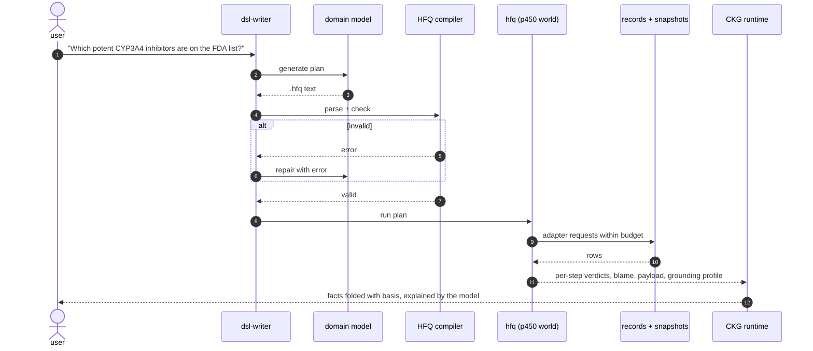

### F6 · The catalytic cycle as a ladder

```mermaid
flowchart LR
  S1[resting LS] -->|p1| S2[substrate HS] -->|p2| S3[ferrous] -->|p3| S4[oxy] -->|p4| S5[peroxo] -->|p5| S6[Compound 0] -->|p6| S7[Compound I]
  S7 -->|p7, product release| S1
  S1 -.-> C["composite = 1 − ∏(1 − pᵢ)"]
  C --> T{≥ declared target?}
  T -->|yes| OK[answered]
  T -->|no| SF[subfloor, shortfall named]
```

### F7 · Refinement and admission

```mermaid
flowchart TD
  RF[(result files)] --> R1[refine every asserted triple]
  R1 --> CELL{records the schema<br/>cannot tell apart?}
  CELL -->|none| DONE[no admission needed]
  CELL -->|cells| CAND[candidate slots from the measured object<br/>and okgg proposals]
  CAND --> A{A1–A6 all hold?}
  A -->|no| REJ[rejected, reason recorded]
  A -->|yes| ADM[(admitted graph)]
  ADM --> RF
```

### F8 · A fact folded onto a catalytic state

```mermaid
flowchart LR
  ST["CKG node: compound-i"] --> F1["fact: Fe=O 795 cm⁻¹<br/>basis stated · ground index"]
  ST --> F2["fact: ΔM = ln 2<br/>basis derived · ground icon"]
  ST --> F3["fact: MS acquisition<br/>basis stated · ground composite"]
```

### F9 · Training and deploying the model

```mermaid
sequenceDiagram
  autonumber
  participant P as laptop
  participant G as Uni Gitea
  participant A as AppHub (GPU)
  participant AI as AppHubAI
  participant B as Buhera dsl-writer
  P->>P: build corpus (licence-filtered)
  P->>G: lattice wrap train --matrix seed=1..3 --matrix size=0.5b,1.5b
  G->>A: git pull, run.sh --detach
  A->>A: LoRA shards in parallel
  A->>G: lattice-results/train
  P->>G: lattice results train --get
  P->>G: lattice wrap eval
  A->>G: lattice-results/eval
  alt gate passes
    P->>AI: serve merged model
    B->>AI: generate plans
  else gate fails
    P->>P: fix corpus, retrain
  end
```

### F10 · Paper lifecycle

See the state diagram in § 6.12. Every transition except the first is checked by a lattice unit.

## 9. Computing on the university servers

### 9.1 Units

Every heavy task is a lattice unit. `lattice plan <task>` prints what a unit needs before anything is
written.

| Unit | Command | Matrix | Profile | Outputs |
|---|---|---|---|---|
| `fetch` | `dcat-ap-plus-p450 fetch {source}` | `source=uniprot,pdb,rhea,chembl,cpic,clinvar,fda` | CPU | `snapshots/**` |
| `validate` | each paper's `validation/run_all.py` | `paper=…` (21) | CPU | `validation/results/**` |
| `catalogue` | `dcat-ap-plus-p450 catalogue --validate` | `--each 'results/inputs/*.json'` | CPU | `results/catalogue/**` |
| `admit` | `dcat-ap-plus-p450 admit` | — | CPU | `results/admission/**` |
| `ontology` | `okgg run … --unit section` | `paper=…` | CPU + AppHubAI | `results/ontology/**` |
| `conformance` | Python ↔ JS HFQ on every plan | — | CPU | `results/conformance.json` |
| `train` | `python model/train/train.py` | `seed=1..3`, `size=0.5b,1.5b` | GPU | adapters |
| `eval` | `python model/eval/eval.py` | `model=…` | GPU | `results/model-eval/**` |

### 9.2 Prerequisites for the route

1. **A university remote.** `levinthal`'s only remote is the public GitHub `origin`. lattice needs a
   repository on `git.uni-greifswald.de`.
2. **A tracker sync manifest** (`.sync.toml`) so the university origin and the public origin each get
   the projection they may see. At minimum, hide `.claude/` and every `.env*` from both.
3. **The gateway credential** in `.claude/settings.local.json` is in pushed public history. It must be
   rotated and the file untracked before any of this (work package WP0.1).

### 9.3 What may be pushed where

| Path | Public GitHub | University Gitea | Reason |
|---|---|---|---|
| `src/`, `tests/`, `docs/`, `web/`, `plans/`, `artefacts/` | yes | yes | own work |
| `snapshots/uniprot`, `pdb`, `rhea`, `chembl`, `cpic`, `clinvar`, `fda` | yes | yes | open licences (ChEMBL is share-alike) |
| `snapshots/kegg` | **no** | yes, if the KEGG licence allows internal use | KEGG forbids redistribution |
| `snapshots/instruments` | ask the lab | yes | lab-owned |
| `model/corpus` | only the open-licence slices | yes | the corpus inherits its sources' licences |
| `.claude/`, `.env*` | **no** | **no** | secrets |

### 9.4 One known gap

okgg's model generator speaks to Ollama. AppHubAI is OpenAI-compatible and does not offer Ollama, and
lattice flags Ollama use. Either okgg gains an OpenAI-compatible generator (upstream in conspirator,
R7), or ontology runs stay local with the lexical generator or a local Ollama.

### 9.5 Experiments: planned here, run there

Every unit in § 9.1 is driven as an **experiment** ([`compute.experiments`](#compute.experiments);
[`experiments/README.md`](../../experiments/README.md)). An experiment is a specification
(`experiments/<id>/experiment.toml`) that states the question it decides, the components it
exercises, the target repository, the command, the shards, any other repositories it needs at pinned
commits, and the checks that judge it. The driver (`dcat-ap-plus-p450 experiment …`) turns it into
lattice calls and records everything, append-only, beside the specification.

```mermaid
stateDiagram-v2
  [*] --> Specified: experiment.toml
  Specified --> Checked: check (spec, route, pinned commits)
  Checked --> Planned: plan (lattice plan, writes nothing)
  Planned --> Wrapped: wrap (asks; commits the unit, pushes)
  Wrapped --> Running: a session on AppHub runs run.sh
  Running --> Collected: collect (files + sha256 from lattice-results)
  Collected --> Concluded: every check passes
  Collected --> Failed: a check fails
  Collected --> Incomplete: a check could not be judged
  Failed --> Specified: revise the specification
```

Facts established while building it (2026-10-09), each enforced by the driver:

| Fact | Consequence |
|---|---|
| lattice reaches a repository only through a push remote on the forge or a `.sync.toml` origin | `doctor` reports the route; 3 of 12 registered repositories are reachable (nfdi4cat-model, doerr-lab-model, raw2dcat-converter). levinthal, hegel, lavoisier, gospel, borgia and conspirator are not, so WP0.2 gates every P450 experiment |
| `lattice wrap` pushes the target's whole current branch, not only the unit | `wrap` prints what goes up with the unit and asks first |
| `run.sh` executes the quoted words after `--` under `bash -c` | commands are always passed as `bash -c '<script>'` |
| lattice reads every `{name}` not preceded by `$` as a matrix placeholder | `check` refuses an unfilled one; a Python f-string in a command is the usual cause. The clone step for `[[requires]]` uses `^0`, not `^{commit}`, for the same reason |
| shard ids are built from matrix values | matrix values are short names, never paths |
| levinthal's root `.gitignore` drops `*.log`, `*.csv`, `*.pdf` at every depth | the wrap log is `wrap.txt`; `collect` lists collected files git would drop |
| lattice analyses the whole target repository | an experiment hosted in an unrelated repository inherits that repository's verdicts (e.g. model use); P450 experiments belong in levinthal once it is reachable |

The first experiments: `e000-route-smoke` (ready: plan verified against nfdi4cat-model),
`e001-okgg-p450-sections` (levinthal + conspirator, blocked on WP0.2), `e002-hfq-baseline` (hegel,
blocked on WP0.2; the baseline WP0.6 needs).

## 10. Construction plan

### 10.1 Work packages and dependencies

```mermaid
flowchart LR
  subgraph P0["Phase 0 · Prerequisites"]
    W01[WP0.1 security] --> W02[WP0.2 university route]
    W01 --> W08[WP0.8 package scaffold]
    W08 --> W03[WP0.3 shared core]
    W03 --> W04[WP0.4 verdict algebra]
    W04 --> W05[WP0.5 ladder semantics]
    W05 --> W06[WP0.6 HFQ conformance]
    W07[WP0.7 upstream defects]
  end
  subgraph P1["Phase 1 · Papers"]
    W11[WP1.1 N2 cycle as ladder] --> W12[WP1.2 expression algebra]
    W12 --> W13[WP1.3 other ladder rewrites]
    W14[WP1.4 merges]
  end
  subgraph P2["Phase 2 · Querying"]
    W21[WP2.1 schema + N1] --> W23[WP2.3 domain modules]
    W22[WP2.2 fetchers] --> W23
    W23 --> W24[WP2.4 emission + catalogue]
    W24 --> W25[WP2.5 HFQ p450 world]
    W25 --> W26[WP2.6 plan library]
    W26 --> W27[WP2.7 Buhera integration]
    W24 --> W28[WP2.8 records sections]
  end
  subgraph P3["Phase 3 · Downstream"]
    W31[WP3.1 refinement + gate] & W32[WP3.2 admission] & W33[WP3.3 grounding] & W34[WP3.4 ontology]
    W35[WP3.5 metabolite ID] & W36[WP3.6 LC] & W37[WP3.7 PGx] & W38[WP3.8 abundance] & W39[WP3.9 spectroscopy] & W310[WP3.10 DDI]
    W311[WP3.11 SPARQL] & W312[WP3.12 consolidation]
  end
  subgraph P4["Phase 4 · Model"]
    W41[WP4.1 corpus] --> W42[WP4.2 baseline 0.5B] --> W43[WP4.3 evaluation] --> W44[WP4.4 merge + size] --> W45[WP4.5 serve + dsl-writer]
  end
  W05 --> W11
  W06 --> W25
  W07 --> W38
  W02 --> W22
  W03 --> W21
  W24 --> P3
  W26 --> W41
  P3 --> W41
```

### 10.2 Work packages

**Phase 0 — Prerequisites**

| WP | Work | Done when | Components |
|---|---|---|---|
| WP0.1 | Untrack `.claude/settings.local.json`, add it to `.gitignore`, rotate the gateway credential | the file is absent from `git ls-files`; the old credential is revoked | — |
| WP0.2 | University remote on `git.uni-greifswald.de`; `.sync.toml` hiding `.claude/`, `.env*`, `snapshots/kegg` from the public origin; `lattice plan validate` dry-run | `tracker sync status` shows the intended projections | `compute.*` |
| WP0.3 | Extract the shared core from chromatography at a pinned commit; `PROVENANCE.md`; port its tests | all ported tests pass; mypy and ruff clean | `core.*` |
| WP0.4 | Canonical step algebra (§ 7.1) in `core.verdicts`, with `from_hfq()` | every HFQ verdict in hegel's V1–V16 maps to exactly one label | `core.verdicts` |
| WP0.5 | Ladder semantics: `subfloor` and the rungless case, in levinthal's ladder engine and hegel's HFQ (Python and JS), with tests; re-vendor to Buhera | both refusals of `def:refuse-climb` and `thm:nonvacuous` are tests that pass | `up.ladderengine`, `up.hfq`, `rt.laddermodule`, `rt.hfqmodule` |
| WP0.6 | Conformance harness: every plan in hegel's `plans/` runs in Python and JS with identical verdicts; decide borgia's copy | harness green; borgia copy re-vendored or retired | `q.conformance` |
| WP0.7 | Upstream defects: U-lev-2, U-lev-3, U-lev-4; genomics `clinvar.py:121` | each has a regression test upstream | `up.levcore`, `up.genomics` |
| WP0.8 | Package scaffold: `pyproject.toml`, `Makefile`, CLI skeleton, CI, `docs/specification/` numbering, synthetic fixtures | `uv run pytest` passes on an empty package | — |

**Phase 1 — Papers**

| WP | Work | Done when |
|---|---|---|
| WP1.1 | N2, the cycle as a ladder; absorbs the closed-orbit paper | validation runs; ladder tests from WP0.5 cited |
| WP1.2 | Expression algebra: oscillator dynamics → ladders | no oscillator dynamics remain; R_bio unchanged; validation runs |
| WP1.3 | Multi-hop ET, address manifold, resting/bound states, Compound I | same criteria |
| WP1.4 | Merge the two isoform papers; merge database recovery with the empty dictionary | one paper each; the empty-dictionary paper becomes the bridge to N3 |

**Phase 2 — Querying**

| WP | Work | Done when |
|---|---|---|
| WP2.1 | `p450.yaml`, `refined.yaml`, `witness.yaml`; artefacts; census and receiver audit; N1 alongside | zero lost pairs; measured and computed spectra keep distinct IRIs |
| WP2.2 | Fetchers for UniProt, PDB, Rhea, KEGG, ChEMBL as lattice unit `fetch` | snapshots with manifests; re-fetch without upstream change is a no-op |
| WP2.3 | `isoforms`, `structures`, `cycle`, `kinetics`, `chemistry` | each module's acceptance in § 6.6 |
| WP2.4 | Emission and catalogue (lattice unit `catalogue`) | every file conforms and round-trips |
| WP2.5 | HFQ `p450` world, predicates, maps, data-derived ladders, upstream in hegel | hegel validation extended with P450 checks, all hold |
| WP2.6 | Plan library: one plan per claim, expected verdicts as tests | every plan returns its expected verdict |
| WP2.7 | Buhera: re-vendor, `cytochrome-module` reads records, CKG facts carry basis | `/protein-modelling` renders with no constant copied from a paper |
| WP2.8 | "Records and queries" sections in the 15 papers | each section lists its triples, plans and cells |

**Phase 3 — Downstream**

| WP | Work | Done when |
|---|---|---|
| WP3.1 | Refinement and gate over the catalogue | conservativity holds; empty answers carry letters |
| WP3.2 | Admission for P450 (lattice unit `admit`) | admitted slots satisfy A1–A6, beside random controls |
| WP3.3 | Grounding profile beside every answer | Q_g, Q_c, Q_d run on the catalogue |
| WP3.4 | Ontology over papers and records; okgg generator decision (§ 9.4) | facets reported; proposals routed to admission only |
| WP3.5 | Metabolite ID: rules, element set with F/Br/I/Fe, isotope model; N4 | precision on a held-out set reported beside chance |
| WP3.6 | LC corroboration | parent/metabolite visibility reported |
| WP3.7 | PGx: PharmVar/CPIC fetch, caller, CYP2D6 CNV/hybrids; N5 | CPIC tables reproduced; ClinVar drug response kept |
| WP3.8 | CYP abundance (after U-lev-2) | surrogate peptides mapped by sequence |
| WP3.9 | Spectroscopy readers (EPR, rR, Mössbauer new); N7 | minimal probe set of `exp_04_panel` reproduced on records |
| WP3.10 | DDI and clearance; N6 | FDA index pairs recovered |
| WP3.11 | SPARQL endpoint | the three grounding queries run through it |
| WP3.12 | Consolidation: purpose pack, bloodhound catalogue, kwisatz papers read from the library | no second copy of a P450 value remains |

**Phase 4 — Model**

| WP | Work | Done when |
|---|---|---|
| WP4.1 | Corpus builder; licence filter | every line traceable to a plan, run, record or paper section |
| WP4.2 | Baseline Qwen2.5 0.5B LoRA (lattice unit `train`) | trained adapters on `lattice-results/train` |
| WP4.3 | Evaluation harness (§ 6.11) | metrics reported per seed |
| WP4.4 | TIES merge; decide size | the gates in § 6.11 pass |
| WP4.5 | Serve on AppHubAI; dsl-writer integration; N8; the introduction | dsl-writer uses the model for `hfq`; repair rate tracked |

## 11. Verification

```mermaid
flowchart BT
  U["unit tests<br/>synthetic fixtures, no network"] --> I["integration<br/>module → records → SHACL → round-trip"]
  I --> C["conformance<br/>HFQ Python = HFQ JS"]
  C --> P["claim tests<br/>every plan returns its stated verdict"]
  P --> V["paper validation<br/>lattice unit validate"]
  V --> M["model gates<br/>§ 6.11"]
```

- Tests never touch the network. Each module is tested on synthetic fixtures, following proteomics'
  `tests/synthetic.py`.
- Every number on the front page is checked against the records it reads from (R12).
- `render_reference.py --check` fails if this document's reference has drifted from `components.json`;
  `web`'s `npm run check` fails if any edge in `components.json` does not resolve.
- Negative controls are kept beside every positive result, as in proteomics (chance precision) and
  admission (random controls).

## 12. Risks and open decisions

### 12.1 Risks

| Risk | Consequence | Mitigation |
|---|---|---|
| Credential in public history | account misuse | WP0.1 before anything else |
| Licences of KEGG, PharmVar, instrument data | redistribution violation; tainted model | § 9.3 projections; licence filter in WP4.1 |
| AppHub may not reach external APIs | `fetch` cannot run there | run `fetch` on the laptop, push snapshots through Gitea |
| Three HFQ copies drift | different answers by runtime | WP0.6 conformance in CI |
| Framework quantities read as clinical values | misleading report | R6, R12, basis on every CKG fact (§ 6.10) |
| Substrate-scope questions | the model invents scope | R9; refusal examples in the corpus |
| raw2dcat source missing on `main` | that code cannot be reused | ask the user (D9) |
| Scope creep across 101 components | nothing finishes | phases gate on acceptance criteria, not on calendar |

### 12.2 Decisions needed

| # | Decision | Default if not decided |
|---|---|---|
| D1 | `dcat-ap-plus-p450` location | **decided:** `levinthal/dcat-ap-plus-p450` |
| D2 | Where the shared core lives | inside this package until a second extension adopts it |
| D3 | Stop citing `cytochrome/sources/` as the foundation | yes; ground on `models/sources/` and the ladder papers |
| D4 | The library's position on substrate scope | record, never infer (R9) |
| D5 | First-release sources | the open-licence set in § 6.2 |
| D6 | Model size and AppHub budget | 0.5B baseline, then decide |
| D7 | Rewrite `cytochrome-module` in place or add a `p450` module | add a `p450` module; keep the current one as the transaminase demo |
| D8 | Verdict for a rungless ladder | `empty`, as the paper says |
| D9 | Where raw2dcat's `kg`/`federation` source is | — |

## 13. Component reference

Generated from `components.json`. Edit the JSON, then run `python render_reference.py`.

<!-- BEGIN COMPONENT REFERENCE (generated by render_reference.py; do not edit by hand) -->

102 components and 173 connections, from `components.json` version 0.2.0 (2026-10-09).

### 00 · University compute

Where every heavy task runs: AppHub sessions reached through lattice units carried by the university Gitea.

| Component | Status | Phase | Repository |
|---|---|---|---|
| [Uni Gitea](#compute.gitea) | External | 0 Prerequisites | `git.uni-greifswald.de` |
| [lattice](#compute.lattice) | Exists | 0 Prerequisites | `distributed/pylon` |
| [AppHub](#compute.apphub) | External | 0 Prerequisites | `Uni Greifswald` |
| [AppHubAI](#compute.apphubai) | External | 0 Prerequisites | `Uni Greifswald` |
| [tracker sync](#compute.tracker) | Exists | 0 Prerequisites | `tracker` |
| [experiment ledger](#compute.experiments) | New | 0 Prerequisites | `levinthal` |

<a id="compute.gitea"></a>

#### Uni Gitea  `compute.gitea`

*External* · phase 0 (Prerequisites) · `git.uni-greifswald.de`

Carries lattice units to AppHub and results back. levinthal needs a university remote or a tracker sync manifest that hides .claude/.

- Connections:
  - from *feeds*: [lattice](#compute.lattice) (pushes units), [AppHub](#compute.apphub) (lattice-results branch), [tracker sync](#compute.tracker) (filtered projection)
  - to *feeds*: [AppHub](#compute.apphub) (git pull), [experiment ledger](#compute.experiments) (lattice-results branch)

<a id="compute.lattice"></a>

#### lattice  `compute.lattice`

*Exists* · phase 0 (Prerequisites) · `distributed/pylon` · `lattice/`

Wraps a task into a runnable unit: works out environment, GPU need, secrets and shards on the laptop; run.sh on AppHub needs only bash and git.

- Connections:
  - from *runs on*: [experiment ledger](#compute.experiments) (plan · wrap · results), [LoRA training](#llm.train), [evaluation](#llm.eval), [snapshot fetchers](#dom.fetch), [result files](#rec.catalogue) (catalogue build), [schema admission](#sem.admission), [ontology (okgg)](#sem.ontology) (ollama -> AppHubAI), [records sections (15)](#pap.records) (validation scripts)
  - to *feeds*: [Uni Gitea](#compute.gitea) (pushes units)

<a id="compute.apphub"></a>

#### AppHub  `compute.apphub`

*External* · phase 0 (Prerequisites) · `Uni Greifswald`

Code-Server sessions with CPU and GPU profiles. Accepts no inbound connection; clones from Gitea, pushes results to lattice-results branches.

- Connections:
  - from *feeds*: [Uni Gitea](#compute.gitea) (git pull), [AppHubAI](#compute.apphubai) (model endpoint)
  - from *runs on*: [experiment ledger](#compute.experiments) (units)
  - to *feeds*: [Uni Gitea](#compute.gitea) (lattice-results branch)

<a id="compute.apphubai"></a>

#### AppHubAI  `compute.apphubai`

*External* · phase 0 (Prerequisites) · `Uni Greifswald`

OpenAI-compatible model endpoint on AppHub. lattice points clients at it; the trained model can be served here.

- Connections:
  - from *runs on*: [serving](#llm.serve)
  - to *feeds*: [AppHub](#compute.apphub) (model endpoint)

<a id="compute.tracker"></a>

#### tracker sync  `compute.tracker`

*Exists* · phase 0 (Prerequisites) · `tracker` · `.sync.toml`

Pushes each origin the projection it may see. Used to keep .claude/ and other private paths off the university origin.

- Connections:
  - to *feeds*: [Uni Gitea](#compute.gitea) (filtered projection)

<a id="compute.experiments"></a>

#### experiment ledger  `compute.experiments`

*New* · phase 0 (Prerequisites) · `levinthal` · `dcat-ap-plus-p450/experiments/ ; src/dcat_ap_plus_p450/experiments/`

Experiments planned here and run on AppHub through lattice: a spec per experiment (question, components, target repository, command, pinned requires, checks), an append-only record of every plan, wrap and collection, and verdicts judged here.

- Connections:
  - from *feeds*: [Uni Gitea](#compute.gitea) (lattice-results branch)
  - to *runs on*: [lattice](#compute.lattice) (plan · wrap · results), [AppHub](#compute.apphub) (units)

### 01 · Sources

External databases and instrument files, read only through dated, content-addressed snapshots.

| Component | Status | Phase | Repository |
|---|---|---|---|
| [UniProt](#src.uniprot) | External | 2 Querying | `uniprot.org` |
| [PDB](#src.pdb) | External | 2 Querying | `rcsb.org` |
| [Rhea](#src.rhea) | External | 2 Querying | `rhea-db.org` |
| [KEGG](#src.kegg) | External | 2 Querying | `kegg.jp` |
| [ChEMBL](#src.chembl) | External | 2 Querying | `ebi.ac.uk/chembl` |
| [PharmVar](#src.pharmvar) | External | 3 Downstream | `pharmvar.org` |
| [CPIC](#src.cpic) | External | 3 Downstream | `cpicpgx.org` |
| [ClinVar](#src.clinvar) | External | 3 Downstream | `ncbi.nlm.nih.gov/clinvar` |
| [FDA DDI tables](#src.fda) | External | 3 Downstream | `fda.gov` |
| [Spectral libraries](#src.spectral) | External | 3 Downstream | `MassBank / GNPS / MoNA` |
| [Instrument files](#src.instruments) | External | 3 Downstream | `lab` |
| [Monograph corpus](#src.monograph) | Exists | 1 Papers | `levinthal` |

<a id="src.uniprot"></a>

#### UniProt  `src.uniprot`

*External* · phase 2 (Querying) · `uniprot.org`

Sequences and features of the 57 human CYPs, CPR (POR) and cytochrome b5.

- Connections:
  - to *snapshots*: [snapshot fetchers](#dom.fetch)

<a id="src.pdb"></a>

#### PDB  `src.pdb`

*External* · phase 2 (Querying) · `rcsb.org`

CYP structures (1TQN for CYP3A4 and others): heme site, access channels, ligand complexes.

- Connections:
  - to *snapshots*: [snapshot fetchers](#dom.fetch)

<a id="src.rhea"></a>

#### Rhea  `src.rhea`

*External* · phase 2 (Querying) · `rhea-db.org`

Reactions catalysed by EC 1.14.14.1 and relatives, with ChEBI participants.

- Connections:
  - to *snapshots*: [snapshot fetchers](#dom.fetch)

<a id="src.kegg"></a>

#### KEGG  `src.kegg`

*External* · phase 2 (Querying) · `kegg.jp`

Pathways hsa00982, hsa00983 (drug metabolism), hsa00140 (steroids), hsa00590 (arachidonic acid). Licence to check before redistribution.

- Connections:
  - to *snapshots*: [snapshot fetchers](#dom.fetch)

<a id="src.chembl"></a>

#### ChEMBL  `src.chembl`

*External* · phase 2 (Querying) · `ebi.ac.uk/chembl`

Activities against CYP targets: Ki, IC50, time-dependent inhibition. CC BY-SA.

- Connections:
  - to *snapshots*: [snapshot fetchers](#dom.fetch)

<a id="src.pharmvar"></a>

#### PharmVar  `src.pharmvar`

*External* · phase 3 (Downstream) · `pharmvar.org`

Star-allele definitions for CYP2D6, 2C19, 2C9, 3A5, 2B6 and others.

- Connections:
  - to *snapshots*: [snapshot fetchers](#dom.fetch)

<a id="src.cpic"></a>

#### CPIC  `src.cpic`

*External* · phase 3 (Downstream) · `cpicpgx.org`

Allele function, activity scores, diplotype-to-phenotype tables, guidelines.

- Connections:
  - to *snapshots*: [snapshot fetchers](#dom.fetch)

<a id="src.clinvar"></a>

#### ClinVar  `src.clinvar`

*External* · phase 3 (Downstream) · `ncbi.nlm.nih.gov/clinvar`

Variant submissions including drug-response significance; already parsed by the genomics extension.

- Connections:
  - to *snapshots*: [snapshot fetchers](#dom.fetch)

<a id="src.fda"></a>

#### FDA DDI tables  `src.fda`

*External* · phase 3 (Downstream) · `fda.gov`

Index substrates, inhibitors and inducers by isoform and strength: the reference set for DDI validation.

- Connections:
  - to *snapshots*: [snapshot fetchers](#dom.fetch)

<a id="src.spectral"></a>

#### Spectral libraries  `src.spectral`

*External* · phase 3 (Downstream) · `MassBank / GNPS / MoNA`

Reference MS/MS spectra for drugs and metabolites.

- Connections:
  - to *snapshots*: [snapshot fetchers](#dom.fetch)

<a id="src.instruments"></a>

#### Instrument files  `src.instruments`

*External* · phase 3 (Downstream) · `lab`

UV-vis (Soret, CO-difference), LC-MS, HPLC raw files from assays.

- Connections:
  - to *feeds*: [spectroscopy](#dom.spectroscopy), [metabolite ID](#dom.metabolites), [LC corroboration](#dom.chromatography)

<a id="src.monograph"></a>

#### Monograph corpus  `src.monograph`

*Exists* · phase 1 (Papers) · `levinthal` · `cytochrome/publications/`

21 existing P450 papers with validation scripts; the stated claims the library starts from.

- Connections:
  - to *emits*: [stated graph](#rec.stated) (claims as statements)
  - to *feeds*: [ladder rewrites (6)](#pap.ladder), [records sections (15)](#pap.records)

### 02 · Upstream code

Implemented and tested modules in the user's other repositories that this package reuses.

| Component | Status | Phase | Repository |
|---|---|---|---|
| [DCAT-AP-PLUS](#up.dcatbase) | Exists | 0 Prerequisites | `greifswald/conspirator` |
| [Chem-DCAT-AP](#up.chemdcat) | Exists | 0 Prerequisites | `greifswald/ultraviolet` |
| [chromatography ext.](#up.chromatography) | Exists | 0 Prerequisites | `bioinformatics/borgia` |
| [proteomics ext.](#up.proteomics) | Exists | 0 Prerequisites | `bioinformatics/lavoisier` |
| [genomics ext.](#up.genomics) | Exists | 0 Prerequisites | `bioinformatics/gospel` |
| [conspirator ART](#up.conspirator) | Exists | 0 Prerequisites | `greifswald/conspirator` |
| [okgg](#up.okgg) | Exists | 0 Prerequisites | `greifswald/conspirator` |
| [HFQ](#up.hfq) | Exists | 0 Prerequisites | `systems/hegel` |
| [HFQ biocat](#up.biocat) | Adapt | 0 Prerequisites | `systems/hegel` |
| [SBS](#up.sbs) | Adapt | 0 Prerequisites | `systems/hegel` |
| [seven-state probe panel](#up.probepanel) | Exists | 0 Prerequisites | `systems/hegel` |
| [ladder engine](#up.ladderengine) | Exists | 0 Prerequisites | `levinthal` |
| [honjo-masamune](#up.honjo) | Adapt | 0 Prerequisites | `bioinformatics/borgia` |
| [CASMI + matchms](#up.casmi) | Adapt | 0 Prerequisites | `bioinformatics/lavoisier` |
| [labdatareader](#up.labdatareader) | Exists | 0 Prerequisites | `greifswald/ultraviolet` |
| [raw2dcat](#up.raw2dcat) | Adapt | 0 Prerequisites | `greifswald/raw2dcat-converter` |
| [levinthal-core](#up.levcore) | Adapt | 0 Prerequisites | `levinthal` |
| [LoRA + TIES recipe](#up.loraRecipe) | Exists | 0 Prerequisites | `greifswald/doerr-lab-model` |
| [corpus builder](#up.corpusBuilder) | Adapt | 0 Prerequisites | `greifswald/nfdi4cat-model` |

<a id="up.dcatbase"></a>

#### DCAT-AP-PLUS  `up.dcatbase`

*Exists* · phase 0 (Prerequisites) · `greifswald/conspirator` · `dcat-ap-plus/src/dcat_ap_plus/schema/dcat_ap_plus.yaml`

The base LinkML schema: Dataset, DataGeneratingActivity, EvaluatedEntity, AgenticEntity, Device, attributes with QUDT.

- Connections:
  - to *reuses*: [p450.yaml](#schema.p450) (imports)

<a id="up.chemdcat"></a>

#### Chem-DCAT-AP  `up.chemdcat`

*Exists* · phase 0 (Prerequisites) · `greifswald/ultraviolet` · `chem-dcat-ap/src/chem_dcat_ap/schema/`

Chemistry extension: ChemicalEntity, ChemicalReaction, Catalyst (SIO:010344, slot RXNO:0000425).

- Connections:
  - to *reuses*: [p450.yaml](#schema.p450) (imports)

<a id="up.chromatography"></a>

#### chromatography ext.  `up.chromatography`

*Exists* · phase 0 (Prerequisites) · `bioinformatics/borgia` · `dcat-ap-plus-chromatography/`

Most mature extension (CI, 15 test modules): identifiers, census, refinement, verdicts, linkage, comparability, corroboration. Source of the shared core.

- Connections:
  - to *reuses*: [identifiers](#core.identifiers), [census](#core.census), [refinement](#core.refinement), [linkage](#core.linkage), [provenance](#core.provenance), [verdict lattice](#core.verdicts) (9 step labels, 6 blockers), [LC corroboration](#dom.chromatography) (corroboration)

<a id="up.proteomics"></a>

#### proteomics ext.  `up.proteomics`

*Exists* · phase 0 (Prerequisites) · `bioinformatics/lavoisier` · `dcat-ap-plus-proteomics/`

Template layout: sequence mapping, licence-or-decline search, admission, named-graph emission, catalogue.

- Connections:
  - to *reuses*: [emission](#core.emission), [artefact generator](#core.artefacts), [refined.yaml](#schema.refined), [CYP abundance](#dom.abundance) (sequence mapping), [schema admission](#sem.admission)

<a id="up.genomics"></a>

#### genomics ext.  `up.genomics`

*Exists* · phase 0 (Prerequisites) · `bioinformatics/gospel` · `dcat-ap-plus-genomics/`

ground.py computes the five semiotic verdicts and Q_g/Q_c/Q_d; ClinVar corpus already holds the CYP genes. clinvar.py:121 collapses drug response.

- Connections:
  - to *reuses*: [verdict lattice](#core.verdicts) (5 semiotic verdicts), [artefact generator](#core.artefacts) (repaired SHACL), [pharmacogenomics](#dom.pgx) (ClinVar corpus), [grounding profile](#sem.grounding)

<a id="up.conspirator"></a>

#### conspirator ART  `up.conspirator`

*Exists* · phase 0 (Prerequisites) · `greifswald/conspirator` · `conspirator/src/conspirator/`

Refined triples at load time, the gate letters (+, -, a, open), determine() closure; papers on SGV and schema admission.

- Connections:
  - to *reuses*: [refined triples + gate](#sem.refinement)

<a id="up.okgg"></a>

#### okgg  `up.okgg`

*Exists* · phase 0 (Prerequisites) · `greifswald/conspirator` · `conspirator/okgg/`

Ontological knowledge graph generator: the model proposes distinctions, a lexical witness decides values.

- Connections:
  - to *reuses*: [ontology (okgg)](#sem.ontology)

<a id="up.hfq"></a>

#### HFQ  `up.hfq`

*Exists* · phase 0 (Prerequisites) · `systems/hegel` · `ckg/validation-federated/hfq/ ; consequences/src/lib/hfq/`

Federated plan language: check before contact, water-filled budget, six verdicts with blockers, blame chains, ladder step. Python holds V1-V16; JS is vendored by Buhera.

- Connections:
  - to *feeds*: [HFQ conformance](#q.conformance)
  - to *reuses*: [verdict lattice](#core.verdicts) (6 step verdicts), [HFQ p450 world](#q.world), [hfq module](#rt.hfqmodule) (byte-exact)

<a id="up.biocat"></a>

#### HFQ biocat  `up.biocat`

*Adapt* · phase 0 (Prerequisites) · `systems/hegel` · `ckg/validation-federated/hfq/biocat.py`

Enzyme predicates and adapters (sequence_of, catalysed_reactions, producers_of) with the Doerr Q1-Q5 fixture.

- Connections:
  - to *reuses*: [HFQ p450 world](#q.world), [pharmacology predicates](#q.predicates)

<a id="up.sbs"></a>

#### SBS  `up.sbs`

*Adapt* · phase 0 (Prerequisites) · `systems/hegel` · `sbs/ ; consequences/src/lib/sbs/dsl/`

Systems-biology circuits: conductance, flux, perturbation, cascade 1-prod(1-k). CYP3A4 kinetic stub only.

- Connections:
  - to *reuses*: [DDI & clearance](#dom.ddi)

<a id="up.probepanel"></a>

#### seven-state probe panel  `up.probepanel`

*Exists* · phase 0 (Prerequisites) · `systems/hegel` · `ckg/validation/exp_04_panel.py`

The seven P450 states with UV-vis, EPR, Raman and Mossbauer readouts and an exhaustive minimal-probe search.

- Connections:
  - to *reuses*: [spectroscopy](#dom.spectroscopy), [catalytic cycle (ladder)](#dom.cycle)

<a id="up.ladderengine"></a>

#### ladder engine  `up.ladderengine`

*Exists* · phase 0 (Prerequisites) · `levinthal` · `enzymes/web/src/lib/engine.js`

Contact graphs, intensive power, compositions, Machine.runVerdict. Paper/code mismatch: subfloor vs starved, empty vs ParseError.

- Connections:
  - to *reuses*: [catalytic cycle (ladder)](#dom.cycle), [data-derived ladders](#q.ladders) (computed powers), [ladder module](#rt.laddermodule) (byte-exact)

<a id="up.honjo"></a>

#### honjo-masamune  `up.honjo`

*Adapt* · phase 0 (Prerequisites) · `bioinformatics/borgia` · `honjo-masamune/honjo-py/`

SMILES reader that tags every atom and bond stated or supplied; the .ms plan language. No d-block: iron is out of scope.

- Connections:
  - to *reuses*: [substrate chemistry](#dom.chemistry)

<a id="up.casmi"></a>

#### CASMI + matchms  `up.casmi`

*Adapt* · phase 0 (Prerequisites) · `bioinformatics/lavoisier` · `catalogue/casmi/identify.py ; lavoisier/core/ml/MSAnnotator.py`

Formula and adduct by two agreeing determinations; ModifiedCosine for parent-metabolite matching. Element set lacks F, Br, I, Fe; isotope model silently empty.

- Connections:
  - to *reuses*: [metabolite ID](#dom.metabolites)

<a id="up.labdatareader"></a>

#### labdatareader  `up.labdatareader`

*Exists* · phase 0 (Prerequisites) · `greifswald/ultraviolet` · `labdatareader/labdatareader/methods/absorbance/jasco/`

JASCO UV-vis spectrum and kinetics readers, plus plate readers.

- Connections:
  - to *reuses*: [spectroscopy](#dom.spectroscopy)

<a id="up.raw2dcat"></a>

#### raw2dcat  `up.raw2dcat`

*Adapt* · phase 0 (Prerequisites) · `greifswald/raw2dcat-converter` · `src/raw2dcat/`

HPLC/GC raw files to Chem-DCAT-AP with stated / indicated / supplied statements. kg/, federation/ hold only __pycache__ on main.

- Connections:
  - to *reuses*: [LC corroboration](#dom.chromatography)

<a id="up.levcore"></a>

#### levinthal-core  `up.levcore`

*Adapt* · phase 0 (Prerequisites) · `levinthal` · `crates/levinthal-core/`

Partition states and trajectories. Defects recorded by Buhera: U-lev-2 residue masses ~18.01 Da heavy, U-lev-3 unseeded folding, U-lev-4 constant to_sentropy.

- Connections:
  - to *reuses*: [CYP abundance](#dom.abundance) (after U-lev-2 fix)

<a id="up.loraRecipe"></a>

#### LoRA + TIES recipe  `up.loraRecipe`

*Exists* · phase 0 (Prerequisites) · `greifswald/doerr-lab-model` · `ties_merge.py ; eval.py ; merge.json`

Qwen2.5 base, LoRA rank 16, TIES merge, held-out evaluation.

- Connections:
  - to *reuses*: [LoRA training](#llm.train)

<a id="up.corpusBuilder"></a>

#### corpus builder  `up.corpusBuilder`

*Adapt* · phase 0 (Prerequisites) · `greifswald/nfdi4cat-model` · `build_corpus.py ; bundle/`

Glossary and document to Q&A with masking; an AppHub training bundle.

- Connections:
  - to *reuses*: [training corpus](#llm.corpus)

### 03 · Shared core

dcat-ap-plus-core: the generic machinery extracted from the chromatography extension, shared by all four extensions.

| Component | Status | Phase | Repository |
|---|---|---|---|
| [identifiers](#core.identifiers) | Adapt | 0 Prerequisites | `levinthal` |
| [census](#core.census) | Adapt | 0 Prerequisites | `levinthal` |
| [refinement](#core.refinement) | Adapt | 0 Prerequisites | `levinthal` |
| [verdict lattice](#core.verdicts) | New | 0 Prerequisites | `levinthal` |
| [linkage](#core.linkage) | Adapt | 0 Prerequisites | `levinthal` |
| [provenance](#core.provenance) | Adapt | 0 Prerequisites | `levinthal` |
| [emission](#core.emission) | Adapt | 0 Prerequisites | `levinthal` |
| [artefact generator](#core.artefacts) | Adapt | 0 Prerequisites | `levinthal` |

<a id="core.identifiers"></a>

#### identifiers  `core.identifiers`

*Adapt* · phase 0 (Prerequisites) · `levinthal` · `dcat-ap-plus-p450/src/dcat_ap_plus_core/identifiers.py`

SHA-256 canonical digests and Stage(content, conventions): a stored value is valid only for the state it was computed on.

- Connections:
  - from *reuses*: [chromatography ext.](#up.chromatography)
  - to *reuses*: [snapshot fetchers](#dom.fetch) (snapshot digests)

<a id="core.census"></a>

#### census  `core.census`

*Adapt* · phase 0 (Prerequisites) · `levinthal` · `dcat-ap-plus-p450/src/dcat_ap_plus_core/census.py`

Which distinctions a LinkML schema draws that its emitted RDF cannot carry.

- Connections:
  - from *reuses*: [chromatography ext.](#up.chromatography)
  - to *feeds*: [receiver audit](#schema.audit)

<a id="core.refinement"></a>

#### refinement  `core.refinement`

*Adapt* · phase 0 (Prerequisites) · `levinthal` · `dcat-ap-plus-p450/src/dcat_ap_plus_core/refinement.py`

Canonical nests over asserted triples: level words, exclusion letters, repetitions, cells, pair status.

- Connections:
  - from *reuses*: [chromatography ext.](#up.chromatography)
  - to *reuses*: [refined triples + gate](#sem.refinement)

<a id="core.verdicts"></a>

#### verdict lattice  `core.verdicts`

*New* · phase 0 (Prerequisites) · `levinthal` · `dcat-ap-plus-p450/src/dcat_ap_plus_core/verdicts.py`

One documented algebra: the 9 ordered step labels with 6 blockers from chromatography as canonical, HFQ's 6 step verdicts mapped into it, subfloor added for ladders; the 5 semiotic ground verdicts and the gate letters as orthogonal axes.

- Connections:
  - from *reuses*: [chromatography ext.](#up.chromatography) (9 step labels, 6 blockers), [genomics ext.](#up.genomics) (5 semiotic verdicts), [HFQ](#up.hfq) (6 step verdicts)
  - to *feeds*: [HFQ p450 world](#q.world)

<a id="core.linkage"></a>

#### linkage  `core.linkage`

*Adapt* · phase 0 (Prerequisites) · `levinthal` · `dcat-ap-plus-p450/src/dcat_ap_plus_core/linkage.py`

Elimination before ranking: never return a link the data contradicts. Comparability undecided where either side is supplied.

- Connections:
  - from *reuses*: [chromatography ext.](#up.chromatography)
  - to *reuses*: [kinetics & inhibition](#dom.kinetics)

<a id="core.provenance"></a>

#### provenance  `core.provenance`

*Adapt* · phase 0 (Prerequisites) · `levinthal` · `dcat-ap-plus-p450/src/dcat_ap_plus_core/provenance.py`

Basis tags (stated, supplied, derived) that compose as max; no laundering.

- Connections:
  - from *reuses*: [chromatography ext.](#up.chromatography)
  - to *reuses*: [substrate chemistry](#dom.chemistry)

<a id="core.emission"></a>

#### emission  `core.emission`

*Adapt* · phase 0 (Prerequisites) · `levinthal` · `dcat-ap-plus-p450/src/dcat_ap_plus_core/emission.py`

Named graph per basis, JSON-LD output, SHACL conformance, parse-back round-trip.

- Connections:
  - from *reuses*: [proteomics ext.](#up.proteomics)
  - to *feeds*: [result files](#rec.catalogue)

<a id="core.artefacts"></a>

#### artefact generator  `core.artefacts`

*Adapt* · phase 0 (Prerequisites) · `levinthal` · `dcat-ap-plus-p450/src/dcat_ap_plus_core/artefacts.py`

LinkML to OWL, SHACL and JSON-LD context, with the repaired SHACL fixes from genomics.

- Connections:
  - from *reuses*: [proteomics ext.](#up.proteomics), [genomics ext.](#up.genomics) (repaired SHACL)
  - to *feeds*: [OWL / SHACL / context](#schema.artefacts) (generates)

### 04 · Schema

The LinkML P450 extension, its generated OWL/SHACL/JSON-LD, and its audits.

| Component | Status | Phase | Repository |
|---|---|---|---|
| [p450.yaml](#schema.p450) | New | 2 Querying | `levinthal` |
| [refined.yaml](#schema.refined) | Adapt | 2 Querying | `levinthal` |
| [OWL / SHACL / context](#schema.artefacts) | New | 2 Querying | `levinthal` |
| [receiver audit](#schema.audit) | New | 2 Querying | `levinthal` |
| [witness classes](#schema.witness) | New | 2 Querying | `levinthal` |

<a id="schema.p450"></a>

#### p450.yaml  `schema.p450`

*New* · phase 2 (Querying) · `levinthal` · `dcat-ap-plus-p450/src/dcat_ap_plus_p450/schema/p450.yaml`

Isoform, Allele, Diplotype, Incubation, KineticMeasurement, Inhibition, Metabolite, CatalyticState, SpectralObservation, CatalystRole with its own IRI.

- Connections:
  - from *documents*: [N1 schema](#pap.n1)
  - from *reuses*: [DCAT-AP-PLUS](#up.dcatbase) (imports), [Chem-DCAT-AP](#up.chemdcat) (imports)
  - to *feeds*: [OWL / SHACL / context](#schema.artefacts), [receiver audit](#schema.audit), [witness classes](#schema.witness)

<a id="schema.refined"></a>

#### refined.yaml  `schema.refined`

*Adapt* · phase 2 (Querying) · `levinthal` · `dcat-ap-plus-p450/src/dcat_ap_plus_p450/schema/refined.yaml`

Vocabulary for refined values carried as stage-annotated annotations, never as slots.

- Connections:
  - from *reuses*: [proteomics ext.](#up.proteomics)
  - to *feeds*: [OWL / SHACL / context](#schema.artefacts)

<a id="schema.artefacts"></a>

#### OWL / SHACL / context  `schema.artefacts`

*New* · phase 2 (Querying) · `levinthal` · `dcat-ap-plus-p450/artefacts/`

Generated from the LinkML; committed so consumers need no toolchain.

- Connections:
  - from *conforms to*: [result files](#rec.catalogue) (SHACL)
  - from *feeds*: [artefact generator](#core.artefacts) (generates), [p450.yaml](#schema.p450), [refined.yaml](#schema.refined)

<a id="schema.audit"></a>

#### receiver audit  `schema.audit`

*New* · phase 2 (Querying) · `levinthal` · `dcat-ap-plus-p450/docs/specification/`

Census plus semiotic receiver audit: zero lost pairs; measured and computed observations keep distinct IRIs.

- Connections:
  - from *documents*: [N1 schema](#pap.n1)
  - from *feeds*: [census](#core.census), [p450.yaml](#schema.p450)

<a id="schema.witness"></a>

#### witness classes  `schema.witness`

*New* · phase 2 (Querying) · `levinthal` · `dcat-ap-plus-p450/src/dcat_ap_plus_p450/schema/witness.yaml`

The declared A_c, U_c, A_d, U_d, G_d classes the grounding queries need.

- Connections:
  - from *feeds*: [p450.yaml](#schema.p450)
  - to *feeds*: [grounding profile](#sem.grounding)

### 05 · Domain modules

One module per experimental aspect of P450; each turns snapshots and instrument data into records.

| Component | Status | Phase | Repository |
|---|---|---|---|
| [snapshot fetchers](#dom.fetch) | New | 2 Querying | `levinthal` |
| [isoforms & sequences](#dom.isoforms) | New | 2 Querying | `levinthal` |
| [structures](#dom.structures) | Adapt | 2 Querying | `levinthal` |
| [catalytic cycle (ladder)](#dom.cycle) | New | 2 Querying | `levinthal` |
| [kinetics & inhibition](#dom.kinetics) | New | 2 Querying | `levinthal` |
| [substrate chemistry](#dom.chemistry) | Adapt | 2 Querying | `levinthal` |
| [metabolite ID](#dom.metabolites) | New | 3 Downstream | `levinthal` |
| [LC corroboration](#dom.chromatography) | Adapt | 3 Downstream | `levinthal` |
| [CYP abundance](#dom.abundance) | New | 3 Downstream | `levinthal` |
| [pharmacogenomics](#dom.pgx) | New | 3 Downstream | `levinthal` |
| [spectroscopy](#dom.spectroscopy) | Adapt | 3 Downstream | `levinthal` |
| [DDI & clearance](#dom.ddi) | New | 3 Downstream | `levinthal` |

<a id="dom.fetch"></a>

#### snapshot fetchers  `dom.fetch`

*New* · phase 2 (Querying) · `levinthal` · `dcat-ap-plus-p450/src/dcat_ap_plus_p450/fetch/`

One fetcher per source; writes a dated, digest-named snapshot. The only code that touches the network.

- Connections:
  - from *reuses*: [identifiers](#core.identifiers) (snapshot digests)
  - from *snapshots*: [UniProt](#src.uniprot), [PDB](#src.pdb), [Rhea](#src.rhea), [KEGG](#src.kegg), [ChEMBL](#src.chembl), [PharmVar](#src.pharmvar), [CPIC](#src.cpic), [ClinVar](#src.clinvar), [FDA DDI tables](#src.fda), [Spectral libraries](#src.spectral)
  - to *feeds*: [isoforms & sequences](#dom.isoforms), [structures](#dom.structures), [kinetics & inhibition](#dom.kinetics), [substrate chemistry](#dom.chemistry), [pharmacogenomics](#dom.pgx), [DDI & clearance](#dom.ddi), [metabolite ID](#dom.metabolites), [HFQ p450 world](#q.world) (snapshots only)
  - to *runs on*: [lattice](#compute.lattice)

<a id="dom.isoforms"></a>

#### isoforms & sequences  `dom.isoforms`

*New* · phase 2 (Querying) · `levinthal` · `dcat-ap-plus-p450/src/dcat_ap_plus_p450/isoforms.py`

The 57 human CYPs, families and subfamilies, substrate recognition sites, the CYP2D6/CYP2D7 pair.

- Connections:
  - from *feeds*: [snapshot fetchers](#dom.fetch)
  - to *emits*: [supplied graph](#rec.supplied)
  - to *feeds*: [CYP abundance](#dom.abundance), [pharmacogenomics](#dom.pgx)

<a id="dom.structures"></a>

#### structures  `dom.structures`

*Adapt* · phase 2 (Querying) · `levinthal` · `dcat-ap-plus-p450/src/dcat_ap_plus_p450/structures.py`

PDB and GLB structures, heme site, the glb-structural-input paper's pipeline.

- Connections:
  - from *feeds*: [snapshot fetchers](#dom.fetch)
  - to *emits*: [supplied graph](#rec.supplied)
  - to *feeds*: [catalytic cycle (ladder)](#dom.cycle)

<a id="dom.cycle"></a>

#### catalytic cycle (ladder)  `dom.cycle`

*New* · phase 2 (Querying) · `levinthal` · `dcat-ap-plus-p450/src/dcat_ap_plus_p450/cycle.py`

Seven states as rungs; composite power; subfloor when a state is missing or uncoupled.

- Connections:
  - from *documents*: [ladder rewrites (6)](#pap.ladder), [N2 cycle as ladder](#pap.n2)
  - from *feeds*: [structures](#dom.structures)
  - from *reuses*: [ladder engine](#up.ladderengine), [seven-state probe panel](#up.probepanel)
  - to *emits*: [derived graph](#rec.derived)
  - to *feeds*: [spectroscopy](#dom.spectroscopy) (states to identify)

<a id="dom.kinetics"></a>

#### kinetics & inhibition  `dom.kinetics`

*New* · phase 2 (Querying) · `levinthal` · `dcat-ap-plus-p450/src/dcat_ap_plus_p450/kinetics.py`

Km, Vmax, Ki, IC50, kinact/KI with units and assay conditions; comparability under declared tolerances.

- Connections:
  - from *feeds*: [snapshot fetchers](#dom.fetch)
  - from *reuses*: [linkage](#core.linkage)
  - to *emits*: [supplied graph](#rec.supplied)
  - to *feeds*: [DDI & clearance](#dom.ddi)

<a id="dom.chemistry"></a>

#### substrate chemistry  `dom.chemistry`

*Adapt* · phase 2 (Querying) · `levinthal` · `dcat-ap-plus-p450/src/dcat_ap_plus_p450/chemistry.py`

Substrates and inhibitors with stated/supplied structure; candidate sites of metabolism. Never asserts substrate scope from recorded substrates.

- Connections:
  - from *feeds*: [snapshot fetchers](#dom.fetch)
  - from *reuses*: [honjo-masamune](#up.honjo), [provenance](#core.provenance)
  - to *emits*: [supplied graph](#rec.supplied)
  - to *feeds*: [metabolite ID](#dom.metabolites)

<a id="dom.metabolites"></a>

#### metabolite ID  `dom.metabolites`

*New* · phase 3 (Downstream) · `levinthal` · `dcat-ap-plus-p450/src/dcat_ap_plus_p450/metabolites.py`

Biotransformation mass rules (+15.995, -14.016, +176.032, GSH +305.068), licence only when two determinations agree, else decline with reason.

- Connections:
  - from *documents*: [N4 metabolite ID](#pap.n4)
  - from *feeds*: [Instrument files](#src.instruments), [snapshot fetchers](#dom.fetch), [substrate chemistry](#dom.chemistry), [LC corroboration](#dom.chromatography) (corroborates)
  - from *reuses*: [CASMI + matchms](#up.casmi)
  - to *emits*: [stated graph](#rec.stated), [derived graph](#rec.derived) (licensed IDs)

<a id="dom.chromatography"></a>

#### LC corroboration  `dom.chromatography`

*Adapt* · phase 3 (Downstream) · `levinthal` · `dcat-ap-plus-p450/src/dcat_ap_plus_p450/separation.py`

Retention corroborates an identity and never establishes it: parent and metabolite peaks as fields.

- Connections:
  - from *feeds*: [Instrument files](#src.instruments)
  - from *reuses*: [chromatography ext.](#up.chromatography) (corroboration), [raw2dcat](#up.raw2dcat)
  - to *emits*: [stated graph](#rec.stated)
  - to *feeds*: [metabolite ID](#dom.metabolites) (corroborates)

<a id="dom.abundance"></a>

#### CYP abundance  `dom.abundance`

*New* · phase 3 (Downstream) · `levinthal` · `dcat-ap-plus-p450/src/dcat_ap_plus_p450/abundance.py`

Surrogate peptides per isoform mapped by sequence, Skyline transitions, microsome normalisation.

- Connections:
  - from *feeds*: [isoforms & sequences](#dom.isoforms)
  - from *reuses*: [proteomics ext.](#up.proteomics) (sequence mapping), [levinthal-core](#up.levcore) (after U-lev-2 fix)
  - to *emits*: [derived graph](#rec.derived)

<a id="dom.pgx"></a>

#### pharmacogenomics  `dom.pgx`

*New* · phase 3 (Downstream) · `levinthal` · `dcat-ap-plus-p450/src/dcat_ap_plus_p450/pgx.py`

Star alleles, diplotype activity score (summed, not averaged), phenotype; CYP2D6 copy number and hybrids.

- Connections:
  - from *documents*: [N5 PGx admission](#pap.n5)
  - from *feeds*: [snapshot fetchers](#dom.fetch), [isoforms & sequences](#dom.isoforms)
  - from *reuses*: [genomics ext.](#up.genomics) (ClinVar corpus)
  - to *emits*: [supplied graph](#rec.supplied), [derived graph](#rec.derived) (phenotypes)
  - to *feeds*: [DDI & clearance](#dom.ddi)

<a id="dom.spectroscopy"></a>

#### spectroscopy  `dom.spectroscopy`

*Adapt* · phase 3 (Downstream) · `levinthal` · `dcat-ap-plus-p450/src/dcat_ap_plus_p450/spectroscopy.py`

UV-vis readers now; EPR, resonance Raman, Mossbauer readers new. States identified by the minimal probe set.

- Connections:
  - from *documents*: [N7 spectroscopic discrimination](#pap.n7)
  - from *feeds*: [Instrument files](#src.instruments), [catalytic cycle (ladder)](#dom.cycle) (states to identify)
  - from *reuses*: [seven-state probe panel](#up.probepanel), [labdatareader](#up.labdatareader)
  - to *emits*: [stated graph](#rec.stated) (instrument files)

<a id="dom.ddi"></a>

#### DDI & clearance  `dom.ddi`

*New* · phase 3 (Downstream) · `levinthal` · `dcat-ap-plus-p450/src/dcat_ap_plus_p450/ddi.py`

Inhibition and induction as ladder and cascade steps over drug-metabolism pathways; validated against the FDA index tables.

- Connections:
  - from *documents*: [N6 DDI propagation](#pap.n6)
  - from *feeds*: [snapshot fetchers](#dom.fetch), [kinetics & inhibition](#dom.kinetics), [pharmacogenomics](#dom.pgx)
  - from *reuses*: [SBS](#up.sbs)
  - to *emits*: [derived graph](#rec.derived)

### 06 · Records

Named graphs, one per basis, emitted as JSON-LD result files that conform to the shapes and round-trip.

| Component | Status | Phase | Repository |
|---|---|---|---|
| [stated graph](#rec.stated) | New | 2 Querying | `levinthal` |
| [supplied graph](#rec.supplied) | New | 2 Querying | `levinthal` |
| [derived graph](#rec.derived) | New | 2 Querying | `levinthal` |
| [refined graph](#rec.refined) | New | 3 Downstream | `levinthal` |
| [admitted graph](#rec.admitted) | New | 3 Downstream | `levinthal` |
| [result files](#rec.catalogue) | New | 2 Querying | `levinthal` |

<a id="rec.stated"></a>

#### stated graph  `rec.stated`

*New* · phase 2 (Querying) · `levinthal` · `dcat-ap-plus-p450/results/`

What a source or instrument file says, verbatim.

- Connections:
  - from *emits*: [Monograph corpus](#src.monograph) (claims as statements), [spectroscopy](#dom.spectroscopy) (instrument files), [metabolite ID](#dom.metabolites), [LC corroboration](#dom.chromatography), [records sections (15)](#pap.records)
  - to *feeds*: [result files](#rec.catalogue)

<a id="rec.supplied"></a>

#### supplied graph  `rec.supplied`

*New* · phase 2 (Querying) · `levinthal` · `dcat-ap-plus-p450/results/`

What a convention, a lab or a reference database filled in.

- Connections:
  - from *emits*: [isoforms & sequences](#dom.isoforms), [structures](#dom.structures), [kinetics & inhibition](#dom.kinetics), [substrate chemistry](#dom.chemistry), [pharmacogenomics](#dom.pgx)
  - to *feeds*: [result files](#rec.catalogue)

<a id="rec.derived"></a>

#### derived graph  `rec.derived`

*New* · phase 2 (Querying) · `levinthal` · `dcat-ap-plus-p450/results/`

What a computation in this package concluded, including framework quantities such as aperture depth.

- Connections:
  - from *emits*: [metabolite ID](#dom.metabolites) (licensed IDs), [CYP abundance](#dom.abundance), [catalytic cycle (ladder)](#dom.cycle), [DDI & clearance](#dom.ddi), [pharmacogenomics](#dom.pgx) (phenotypes)
  - to *feeds*: [result files](#rec.catalogue)

<a id="rec.refined"></a>

#### refined graph  `rec.refined`

*New* · phase 3 (Downstream) · `levinthal` · `dcat-ap-plus-p450/results/`

Refined values of every asserted triple, stage-annotated (RDF-star).

- Connections:
  - from *emits*: [refined triples + gate](#sem.refinement)
  - to *feeds*: [result files](#rec.catalogue)

<a id="rec.admitted"></a>

#### admitted graph  `rec.admitted`

*New* · phase 3 (Downstream) · `levinthal` · `dcat-ap-plus-p450/results/`

Slots admitted under A1-A6 to split cells the schema could not.

- Connections:
  - from *emits*: [schema admission](#sem.admission)
  - to *feeds*: [result files](#rec.catalogue)

<a id="rec.catalogue"></a>

#### result files  `rec.catalogue`

*New* · phase 2 (Querying) · `levinthal` · `dcat-ap-plus-p450/results/catalogue/`

One JSON-LD file per dataset with its manifest; conforms to the shapes and parses back to the same quads.

- Connections:
  - from *feeds*: [emission](#core.emission), [stated graph](#rec.stated), [supplied graph](#rec.supplied), [derived graph](#rec.derived), [refined graph](#rec.refined), [admitted graph](#rec.admitted)
  - from *queries*: [HFQ p450 world](#q.world), [SPARQL endpoint](#q.sparql), [cytochrome module](#rt.p450module)
  - to *analyses*: [refined triples + gate](#sem.refinement), [schema admission](#sem.admission), [grounding profile](#sem.grounding), [ontology (okgg)](#sem.ontology)
  - to *conforms to*: [OWL / SHACL / context](#schema.artefacts) (SHACL)
  - to *runs on*: [lattice](#compute.lattice) (catalogue build)
  - to *trains*: [training corpus](#llm.corpus) (graph descriptions)

### 07 · Semantics

What the records support: refined triples, admission, grounding verdicts, the ontology.

| Component | Status | Phase | Repository |
|---|---|---|---|
| [refined triples + gate](#sem.refinement) | Exists | 3 Downstream | `greifswald/conspirator` |
| [schema admission](#sem.admission) | Adapt | 3 Downstream | `levinthal` |
| [grounding profile](#sem.grounding) | Adapt | 3 Downstream | `levinthal` |
| [ontology (okgg)](#sem.ontology) | Exists | 3 Downstream | `greifswald/conspirator` |

<a id="sem.refinement"></a>

#### refined triples + gate  `sem.refinement`

*Exists* · phase 3 (Downstream) · `greifswald/conspirator` · `conspirator/src/conspirator/gate.py`

Empty answers labelled + (witnessed no), - (not recorded), a, open (a name the graph never uses).

- Connections:
  - from *analyses*: [result files](#rec.catalogue)
  - from *reuses*: [conspirator ART](#up.conspirator), [refinement](#core.refinement)
  - to *emits*: [refined graph](#rec.refined)
  - to *feeds*: [HFQ p450 world](#q.world) (gate letters)

<a id="sem.admission"></a>

#### schema admission  `sem.admission`

*Adapt* · phase 3 (Downstream) · `levinthal` · `dcat-ap-plus-p450/src/dcat_ap_plus_p450/admission.py`

Field scores, joins, linking, admitted slots and goals for P450 records.

- Connections:
  - from *analyses*: [result files](#rec.catalogue)
  - from *documents*: [N5 PGx admission](#pap.n5)
  - from *feeds*: [ontology (okgg)](#sem.ontology) (proposed slots)
  - from *reuses*: [proteomics ext.](#up.proteomics)
  - to *emits*: [admitted graph](#rec.admitted)
  - to *runs on*: [lattice](#compute.lattice)

<a id="sem.grounding"></a>

#### grounding profile  `sem.grounding`

*Adapt* · phase 3 (Downstream) · `levinthal` · `dcat-ap-plus-p450/src/dcat_ap_plus_p450/ground.py`

The five semiotic verdicts per record; a grounding profile reported beside every answer.

- Connections:
  - from *analyses*: [result files](#rec.catalogue)
  - from *feeds*: [witness classes](#schema.witness)
  - from *reuses*: [genomics ext.](#up.genomics)
  - to *feeds*: [HFQ p450 world](#q.world) (grounding profile)

<a id="sem.ontology"></a>

#### ontology (okgg)  `sem.ontology`

*Exists* · phase 3 (Downstream) · `greifswald/conspirator` · `conspirator/okgg/`

Facets that tell papers, sections and records apart; proposals for admission.

- Connections:
  - from *analyses*: [result files](#rec.catalogue)
  - from *reuses*: [okgg](#up.okgg)
  - to *feeds*: [schema admission](#sem.admission) (proposed slots)
  - to *runs on*: [lattice](#compute.lattice) (ollama -> AppHubAI)

### 08 · Query

The HFQ p450 world, ladders, the plan library and the SPARQL endpoint.

| Component | Status | Phase | Repository |
|---|---|---|---|
| [HFQ p450 world](#q.world) | New | 2 Querying | `systems/hegel` |
| [pharmacology predicates](#q.predicates) | New | 2 Querying | `systems/hegel` |
| [isoform maps](#q.maps) | New | 2 Querying | `levinthal` |
| [data-derived ladders](#q.ladders) | New | 2 Querying | `systems/hegel` |
| [plan library](#q.plans) | New | 2 Querying | `levinthal` |
| [SPARQL endpoint](#q.sparql) | Adapt | 3 Downstream | `architecture/buhera` |
| [HFQ conformance](#q.conformance) | New | 0 Prerequisites | `systems/hegel` |

<a id="q.world"></a>

#### HFQ p450 world  `q.world`

*New* · phase 2 (Querying) · `systems/hegel` · `ckg/validation-federated/hfq/p450.py`

Adapters over the snapshots and the records; added upstream in hegel, then vendored into Buhera.

- Connections:
  - from *documents*: [N3 federated querying](#pap.n3)
  - from *feeds*: [snapshot fetchers](#dom.fetch) (snapshots only), [pharmacology predicates](#q.predicates), [isoform maps](#q.maps), [data-derived ladders](#q.ladders), [refined triples + gate](#sem.refinement) (gate letters), [grounding profile](#sem.grounding) (grounding profile), [verdict lattice](#core.verdicts)
  - from *queries*: [plan library](#q.plans)
  - from *reuses*: [HFQ](#up.hfq), [HFQ biocat](#up.biocat)
  - to *feeds*: [hfq module](#rt.hfqmodule) (p450 world)
  - to *queries*: [result files](#rec.catalogue)
  - to *trains*: [training corpus](#llm.corpus) (verdicts and blame)

<a id="q.predicates"></a>

#### pharmacology predicates  `q.predicates`

*New* · phase 2 (Querying) · `systems/hegel` · `ckg/validation-federated/hfq/p450.py`

inhibits, induces, substrate_of, metabolite_of, allele_of, activity_score; numeric range filters with units.

- Connections:
  - from *reuses*: [HFQ biocat](#up.biocat)
  - to *feeds*: [HFQ p450 world](#q.world)

<a id="q.maps"></a>

#### isoform maps  `q.maps`

*New* · phase 2 (Querying) · `levinthal` · `dcat-ap-plus-p450/src/dcat_ap_plus_p450/maps.py`

UniProt, EC, KEGG, PDB, ChEMBL target translation maps; retention and amplification measured, not assumed.

- Connections:
  - from *documents*: [N3 federated querying](#pap.n3)
  - to *feeds*: [HFQ p450 world](#q.world)

<a id="q.ladders"></a>

#### data-derived ladders  `q.ladders`

*New* · phase 2 (Querying) · `systems/hegel` · `ckg/validation-federated/hfq/execute.py`

A rung's power taken from a retrieved value or from the ladder engine, instead of a literal.

- Connections:
  - from *documents*: [N2 cycle as ladder](#pap.n2)
  - from *reuses*: [ladder engine](#up.ladderengine) (computed powers)
  - to *feeds*: [HFQ p450 world](#q.world)

<a id="q.plans"></a>

#### plan library  `q.plans`

*New* · phase 2 (Querying) · `levinthal` · `dcat-ap-plus-p450/plans/`

One .hfq plan per claim in the papers, with expected verdicts as tests.

- Connections:
  - from *documents*: [records sections (15)](#pap.records) (one plan per claim)
  - to *queries*: [HFQ p450 world](#q.world)
  - to *trains*: [training corpus](#llm.corpus) (question to plan)

<a id="q.sparql"></a>

#### SPARQL endpoint  `q.sparql`

*Adapt* · phase 3 (Downstream) · `architecture/buhera` · `nfdi4cat/src/transaminase_kg/api.py`

SPARQL over the result files; the transaminase KG service with the enzyme swapped.

- Connections:
  - to *queries*: [result files](#rec.catalogue)

<a id="q.conformance"></a>

#### HFQ conformance  `q.conformance`

*New* · phase 0 (Prerequisites) · `systems/hegel` · `ckg/validation-federated/`

Python and JS interpreters give identical verdicts on every plan; borgia's copy re-vendored or retired.

- Connections:
  - from *feeds*: [HFQ](#up.hfq)
  - to *feeds*: [hfq module](#rt.hfqmodule) (re-vendor)

### 09 · Runtime (Buhera OS)

The OS-wide federation that hosts the library: registry, CKG runtime, modules, front pages.

| Component | Status | Phase | Repository |
|---|---|---|---|
| [Buhera registry](#rt.registry) | Exists | 0 Prerequisites | `architecture/buhera` |
| [CKG runtime](#rt.ckg) | Adapt | 0 Prerequisites | `architecture/buhera` |
| [cytochrome module](#rt.p450module) | Adapt | 2 Querying | `architecture/buhera` |
| [hfq module](#rt.hfqmodule) | Exists | 0 Prerequisites | `architecture/buhera` |
| [ladder module](#rt.laddermodule) | Exists | 0 Prerequisites | `architecture/buhera` |
| [dsl-writer](#rt.dslwriter) | Exists | 0 Prerequisites | `architecture/buhera` |
| [/protein-modelling](#rt.protein) | Adapt | 0 Prerequisites | `architecture/buhera` |
| [p450 front page](#rt.web) | New | 0 Prerequisites | `levinthal` |

<a id="rt.registry"></a>

#### Buhera registry  `rt.registry`

*Exists* · phase 0 (Prerequisites) · `architecture/buhera` · `long-grass/src/lib/modules/registry.js`

One registry dispatches about 40 modules; science modules vendored byte-exact with pinned commits and specs.

- Connections:
  - to *dispatches*: [hfq module](#rt.hfqmodule), [ladder module](#rt.laddermodule), [CKG runtime](#rt.ckg), [dsl-writer](#rt.dslwriter), [cytochrome module](#rt.p450module)

<a id="rt.ckg"></a>

#### CKG runtime  `rt.ckg`

*Adapt* · phase 0 (Prerequisites) · `architecture/buhera` · `long-grass/src/lib/modules/ckg-module.js`

Catalytic states as nodes, modules fold value-deltas onto them. Facts must carry their basis and verdict.

- Connections:
  - from *dispatches*: [Buhera registry](#rt.registry), [/protein-modelling](#rt.protein)
  - to *dispatches*: [cytochrome module](#rt.p450module) (fold facts)

<a id="rt.p450module"></a>

#### cytochrome module  `rt.p450module`

*Adapt* · phase 2 (Querying) · `architecture/buhera` · `long-grass/src/lib/modules/cytochrome-module.js`

Today holds monograph constants; becomes queries over the records.

- Connections:
  - from *dispatches*: [Buhera registry](#rt.registry), [CKG runtime](#rt.ckg) (fold facts)
  - to *queries*: [result files](#rec.catalogue)

<a id="rt.hfqmodule"></a>

#### hfq module  `rt.hfqmodule`

*Exists* · phase 0 (Prerequisites) · `architecture/buhera` · `long-grass/vendor/hfq/`

Vendored hegel JS interpreter; gains the p450 world when re-vendored.

- Connections:
  - from *dispatches*: [Buhera registry](#rt.registry), [dsl-writer](#rt.dslwriter) (validated plan)
  - from *feeds*: [HFQ conformance](#q.conformance) (re-vendor), [HFQ p450 world](#q.world) (p450 world), [ladder module](#rt.laddermodule) (rung powers)
  - from *reuses*: [HFQ](#up.hfq) (byte-exact)
  - to *feeds*: [evaluation](#llm.eval) (runs generated plans)

<a id="rt.laddermodule"></a>

#### ladder module  `rt.laddermodule`

*Exists* · phase 0 (Prerequisites) · `architecture/buhera` · `long-grass/vendor/ladder/`

Vendored ladder engine; computes powers a plan's ladder step can use.

- Connections:
  - from *dispatches*: [Buhera registry](#rt.registry)
  - from *reuses*: [ladder engine](#up.ladderengine) (byte-exact)
  - to *feeds*: [hfq module](#rt.hfqmodule) (rung powers)

<a id="rt.dslwriter"></a>

#### dsl-writer  `rt.dslwriter`

*Exists* · phase 0 (Prerequisites) · `architecture/buhera` · `long-grass/src/lib/modules/dsl-writer-module.js`

Natural language to a DSL script, validated by the real compiler, repaired on failure, dispatched.

- Connections:
  - from *deploys*: [serving](#llm.serve)
  - from *dispatches*: [Buhera registry](#rt.registry)
  - to *dispatches*: [hfq module](#rt.hfqmodule) (validated plan)

<a id="rt.protein"></a>

#### /protein-modelling  `rt.protein`

*Adapt* · phase 0 (Prerequisites) · `architecture/buhera` · `long-grass/src/pages/protein-modelling.js`

The live report and IDE; its numbers will come from the records.

- Connections:
  - from *feeds*: [p450 front page](#rt.web) (links)
  - to *dispatches*: [CKG runtime](#rt.ckg)

<a id="rt.web"></a>

#### p450 front page  `rt.web`

*New* · phase 0 (Prerequisites) · `levinthal` · `dcat-ap-plus-p450/web/`

This site: the component graph, the phases, a page per component.

- Connections:
  - to *feeds*: [/protein-modelling](#rt.protein) (links)

### 10 · Domain LLM

A compiled probe: writes plans, explains verdicts, never states a value no record holds.

| Component | Status | Phase | Repository |
|---|---|---|---|
| [training corpus](#llm.corpus) | New | 4 Model | `levinthal` |
| [LoRA training](#llm.train) | Adapt | 4 Model | `levinthal` |
| [TIES merge](#llm.merge) | Exists | 4 Model | `greifswald/doerr-lab-model` |
| [evaluation](#llm.eval) | New | 4 Model | `levinthal` |
| [serving](#llm.serve) | New | 4 Model | `levinthal` |

<a id="llm.corpus"></a>

#### training corpus  `llm.corpus`

*New* · phase 4 (Model) · `levinthal` · `dcat-ap-plus-p450/model/corpus/`

Question to plan; plan to verdict to explanation, refusals included; paper sections to Q&A; record graphs to descriptions. Licences filtered.

- Connections:
  - from *reuses*: [corpus builder](#up.corpusBuilder)
  - from *trains*: [plan library](#q.plans) (question to plan), [HFQ p450 world](#q.world) (verdicts and blame), [result files](#rec.catalogue) (graph descriptions), [records sections (15)](#pap.records) (sections to Q&A)
  - to *feeds*: [LoRA training](#llm.train)

<a id="llm.train"></a>

#### LoRA training  `llm.train`

*Adapt* · phase 4 (Model) · `levinthal` · `dcat-ap-plus-p450/model/train/`

Qwen2.5 base, LoRA; wrapped as a lattice unit with a seed and size matrix.

- Connections:
  - from *feeds*: [training corpus](#llm.corpus)
  - from *reuses*: [LoRA + TIES recipe](#up.loraRecipe)
  - to *feeds*: [TIES merge](#llm.merge)
  - to *runs on*: [lattice](#compute.lattice)

<a id="llm.merge"></a>

#### TIES merge  `llm.merge`

*Exists* · phase 4 (Model) · `greifswald/doerr-lab-model` · `ties_merge.py`

Merges adapters trained on separate corpus slices.

- Connections:
  - from *feeds*: [LoRA training](#llm.train)
  - to *feeds*: [evaluation](#llm.eval)

<a id="llm.eval"></a>

#### evaluation  `llm.eval`

*New* · phase 4 (Model) · `levinthal` · `dcat-ap-plus-p450/model/eval/`

Plans parse and pass check; verdicts match reference plans; refuses when it should; zero values not backed by a record; dsl-writer repair rate.

- Connections:
  - from *documents*: [N8 domain model](#pap.n8)
  - from *feeds*: [TIES merge](#llm.merge), [hfq module](#rt.hfqmodule) (runs generated plans)
  - to *feeds*: [serving](#llm.serve) (gate)
  - to *runs on*: [lattice](#compute.lattice)

<a id="llm.serve"></a>

#### serving  `llm.serve`

*New* · phase 4 (Model) · `levinthal` · `dcat-ap-plus-p450/model/serve/`

Served on AppHubAI or locally; called by dsl-writer for dslId hfq, later ladder and shapeshifter.

- Connections:
  - from *feeds*: [evaluation](#llm.eval) (gate)
  - to *deploys*: [dsl-writer](#rt.dslwriter)
  - to *runs on*: [AppHubAI](#compute.apphubai)

### 11 · Papers

The argued and validated claims; every paper emits records and ships plans with expected verdicts.

| Component | Status | Phase | Repository |
|---|---|---|---|
| [ladder rewrites (6)](#pap.ladder) | Adapt | 1 Papers | `levinthal` |
| [records sections (15)](#pap.records) | Adapt | 2 Querying | `levinthal` |
| [N1 schema](#pap.n1) | New | 2 Querying | `levinthal` |
| [N2 cycle as ladder](#pap.n2) | New | 1 Papers | `levinthal` |
| [N3 federated querying](#pap.n3) | New | 2 Querying | `levinthal` |
| [N4 metabolite ID](#pap.n4) | New | 3 Downstream | `levinthal` |
| [N5 PGx admission](#pap.n5) | New | 3 Downstream | `levinthal` |
| [N6 DDI propagation](#pap.n6) | New | 3 Downstream | `levinthal` |
| [N7 spectroscopic discrimination](#pap.n7) | New | 3 Downstream | `levinthal` |
| [N8 domain model](#pap.n8) | New | 4 Model | `levinthal` |

<a id="pap.ladder"></a>

#### ladder rewrites (6)  `pap.ladder`

*Adapt* · phase 1 (Papers) · `levinthal` · `cytochrome/publications/`

Expression algebra, multi-hop ET, address manifold, resting/bound states, Compound I, introduction: oscillator dynamics replaced by ladders.

- Connections:
  - from *feeds*: [Monograph corpus](#src.monograph)
  - to *documents*: [catalytic cycle (ladder)](#dom.cycle)
  - to *feeds*: [records sections (15)](#pap.records)

<a id="pap.records"></a>

#### records sections (15)  `pap.records`

*Adapt* · phase 2 (Querying) · `levinthal` · `cytochrome/publications/`

Every paper gains 'Records and queries': the triples it emits, the plans that answer it, the cells it cannot separate.

- Connections:
  - from *feeds*: [Monograph corpus](#src.monograph), [ladder rewrites (6)](#pap.ladder)
  - to *documents*: [plan library](#q.plans) (one plan per claim)
  - to *emits*: [stated graph](#rec.stated)
  - to *runs on*: [lattice](#compute.lattice) (validation scripts)
  - to *trains*: [training corpus](#llm.corpus) (sections to Q&A)

<a id="pap.n1"></a>

#### N1 schema  `pap.n1`

*New* · phase 2 (Querying) · `levinthal` · `dcat-ap-plus-p450/docs/dcat-ap-plus-p450/dcat-ap-plus-450.tex`

The P450 extension of DCAT-AP-PLUS, its census and receiver audit.

- Connections:
  - to *documents*: [p450.yaml](#schema.p450), [receiver audit](#schema.audit)

<a id="pap.n2"></a>

#### N2 cycle as ladder  `pap.n2`

*New* · phase 1 (Papers) · `levinthal`

Seven states as rungs; absorbs the closed-orbit paper.

- Connections:
  - to *documents*: [catalytic cycle (ladder)](#dom.cycle), [data-derived ladders](#q.ladders)

<a id="pap.n3"></a>

#### N3 federated querying  `pap.n3`

*New* · phase 2 (Querying) · `levinthal`

Snapshots, predicates, isoform maps, and the position on substrate scope.

- Connections:
  - to *documents*: [HFQ p450 world](#q.world), [isoform maps](#q.maps)

<a id="pap.n4"></a>

#### N4 metabolite ID  `pap.n4`

*New* · phase 3 (Downstream) · `levinthal`

Biotransformation rules with licence or decline, corroborated by retention.

- Connections:
  - to *documents*: [metabolite ID](#dom.metabolites)

<a id="pap.n5"></a>

#### N5 PGx admission  `pap.n5`

*New* · phase 3 (Downstream) · `levinthal`

Star alleles, activity scores, which genotype fields to admit.

- Connections:
  - to *documents*: [pharmacogenomics](#dom.pgx), [schema admission](#sem.admission)

<a id="pap.n6"></a>

#### N6 DDI propagation  `pap.n6`

*New* · phase 3 (Downstream) · `levinthal`

Inhibition and induction as ladder and cascade propagation.

- Connections:
  - to *documents*: [DDI & clearance](#dom.ddi)

<a id="pap.n7"></a>

#### N7 spectroscopic discrimination  `pap.n7`

*New* · phase 3 (Downstream) · `levinthal`

The minimal probe set that separates the seven states.

- Connections:
  - to *documents*: [spectroscopy](#dom.spectroscopy)

<a id="pap.n8"></a>

#### N8 domain model  `pap.n8`

*New* · phase 4 (Model) · `levinthal`

The model as a compiled probe, and its evaluation.

- Connections:
  - to *documents*: [evaluation](#llm.eval)

<!-- END COMPONENT REFERENCE -->
