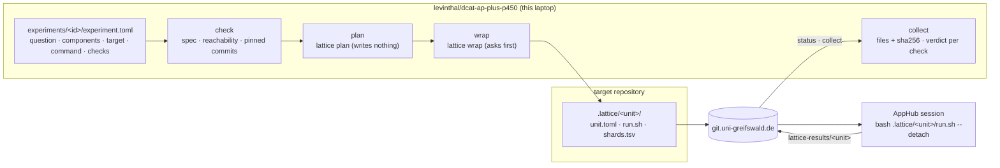

# Experiments

An experiment is **planned here, run on the university cluster, and judged here**.
The cluster is AppHub (Uni Greifswald); the carrier is [lattice](../../../../distributed/pylon/lattice/README.md),
which turns a repository and a command into a unit that AppHub can pull and run.
This directory holds the plans and the record of every run; the code that drives
lattice is `src/dcat_ap_plus_p450/experiments/`.



## Commands

Run from `dcat-ap-plus-p450/` (`uv run` builds the package the first time):

```bash
uv run dcat-ap-plus-p450 experiment doctor              # lattice, the forge, which repositories it can reach
uv run dcat-ap-plus-p450 experiment list                # every experiment and where it stands
uv run dcat-ap-plus-p450 experiment new e003-name --repo hegel --title "…"
uv run dcat-ap-plus-p450 experiment check e000-route-smoke
uv run dcat-ap-plus-p450 experiment plan  e000-route-smoke    # what the unit needs on AppHub
uv run dcat-ap-plus-p450 experiment wrap  e000-route-smoke    # commit the unit, push it (asks first)
#   … on AppHub: git pull, then bash .lattice/p450-e000-route-smoke/run.sh --detach
uv run dcat-ap-plus-p450 experiment status  e000-route-smoke  # shard states from the results branch
uv run dcat-ap-plus-p450 experiment collect e000-route-smoke  # copy results here, judge the checks
```

Exit codes: `0` fine or concluded; `1` problems or a failed check; `2` blocked
(unreachable repository, lattice missing, lattice error); `3` incomplete (a check
could not be judged; never counted as a pass).

## What an experiment is

`experiments/<id>/experiment.toml` (copy `_template/`):

| Table | Says |
|---|---|
| `[experiment]` | `id` (= directory, `e` + 3 digits + name), `title`, the `question` the run decides, and the `components` of [`components.json`](../docs/specifications/components.json) it exercises |
| `[target]` | the `repo` (a key in [`repos.toml`](repos.toml)) the unit is committed in and AppHub clones; exactly one of a lattice `task` or a `command`; the `unit` name (default `p450-<id>`) |
| `[run]` | lattice's options: `matrix` or `each`, `outputs`, `env`, `secrets`, `gpu`, `parallel`, `timeout_secs` |
| `[[requires]]` | other repositories the command needs, cloned beside the target at a commit pinned when you wrap |
| `[[expect]]` | how the run is judged: `shards` (all `done`), `file` (exists), `json` (a key satisfies `exists/eq/ne/lt/le/gt/ge`) |

Rules the driver enforces before lattice is called:

- **Every experiment states its question and names its components.** An experiment
  is anchored in the component graph or it is not specified.
- **Every experiment has at least one check.** A run with no acceptance criterion
  cannot conclude.
- **A command always runs as `bash -c '<script>'`.** lattice's `run.sh` executes the
  quoted words after `--`; a bare string with `&&` or `>` would become one quoted word.
- **Matrix values are short names, not paths.** Shard ids are built from them.
  Use `$LATTICE_<KEY>` in the command, not lattice's `{key}` placeholder.
- **Required repositories are pinned.** `ref` resolves to a commit on this machine at
  wrap time; the commit must already be on the forge, or AppHub cannot fetch it.
  Clones are serialised with `flock` because all shards share one checkout.
- **Only committed files reach AppHub.** The driver warns about uncommitted changes in
  the target; anything else the command needs, it must fetch.

## What `wrap` pushes

`lattice wrap` commits only `.lattice/<unit>/`, but it pushes the target repository's
**whole current branch**. `wrap` therefore prints how many commits go up with the unit
(or that the branch is new on the remote, so its whole history goes) and asks before
doing anything. `--no-push` commits without pushing; `--yes` skips the question.

## What is recorded

Append-only: a file is created once and never rewritten.

```
experiments/<id>/
  experiment.toml
  plans/<t>.txt                 lattice plan output, with the spec digest
  runs/<t>/wrap.json            spec sha256, unit, repository, route, commits before/after, pinned requires, argv
  runs/<t>/wrap.txt             lattice's output (not .log: the root .gitignore drops *.log)
  runs/<t>/status-<t>.json      shard states read from lattice-results/<unit> at revision …
  runs/<t>/collect-<t>.json     every collected file with its sha256; the verdict of every check; overall
  runs/<t>/collect-<t>/         shards/<shard>/<file>, shards/<shard>/log, outputs/<path>
```

A collection names the results revision it read and the spec digest it judged against,
so a verdict can always be traced to exactly what produced it.

## Which repositories lattice can reach

lattice pushes a unit only through a **push remote on `git.uni-greifswald.de`** or a
**tracker origin in `.sync.toml`**. `doctor` shows the route for every repository in
`repos.toml`. On 2026-10-09 only `nfdi4cat-model` and `doerr-lab-model` had one (and
`raw2dcat-converter`, which belongs to Mark Doerr). levinthal, lavoisier, gospel, borgia,
hegel and conspirator had none, so `e001` and `e002` are **blocked** until they get one
(components-graph.md, WP0.2). For levinthal, the gateway credential in
`.claude/settings.local.json` must be rotated and hidden from that origin first (WP0.1).

## The experiments

| Id | Target | Decides | Status on 2026-10-09 |
|---|---|---|---|
| [`e000-route-smoke`](e000-route-smoke/experiment.toml) | nfdi4cat-model | whether the route works end to end, and what an AppHub CPU session offers | ready to plan and wrap |
| [`e001-okgg-p450-sections`](e001-okgg-p450-sections/experiment.toml) | levinthal + conspirator | which sections of each P450 paper okgg can tell apart | blocked: no forge route for either repository |
| [`e002-hfq-baseline`](e002-hfq-baseline/experiment.toml) | hegel | whether HFQ V1–V16 hold on AppHub, as the WP0.6 baseline | blocked: no forge route |
